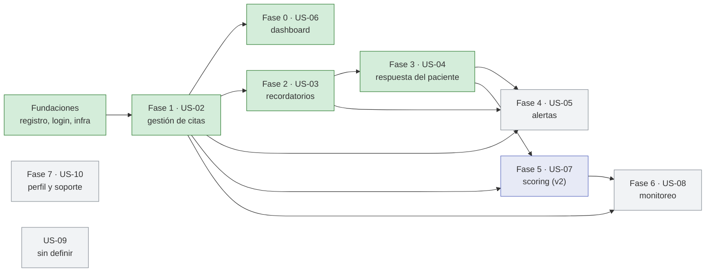

# El roadmap y las fases de construcción

> **Qué vas a entender acá:** qué es el roadmap de Citia, por qué el trabajo se ordena en fases y no
> en otro orden, en qué estado está cada fase al 2026-10-18 y, fase por fase, qué problema resuelve,
> qué se construyó, qué se decidió y qué quedó pendiente. Al final, cómo usar `TRAZABILIDAD.md` y las
> guías de `context/Fases/` para encontrar cualquier cosa.
>
> **Antes conviene leer:** [01 — El producto](01-el-producto.md) (para saber qué problema ataca Citia)
> y [02 — Cómo está armado](02-como-esta-armado.md) (stack, módulos, entornos). Las decisiones que se
> nombran acá están explicadas en [03 — Decisiones (ADR)](03-decisiones-adr.md), y los términos raros,
> en el [glosario](11-glosario.md).

---

## Qué es el roadmap

El [`ROADMAP.md`](../ROADMAP.md) es la hoja de ruta del proyecto: dice **qué se construye, en qué
orden y en qué estado está cada pieza**. Piénsalo como el plan de obra de una casa: primero los
cimientos, después los muros, después el techo. No puedes poner el techo si no hay muros, y no tiene
sentido pintar antes de tener paredes.

Cada pedazo del plan es una **fase**. Una fase casi siempre corresponde a una **historia de usuario**
(una US, algo que el usuario quiere poder hacer, como "ver mis citas de hoy"). Las reglas son simples:

- **Cada fase se puede entregar y probar sola.** Al terminarla, el producto hace algo nuevo que
  funciona de punta a punta, no un pedazo a medias.
- **El orden lo ponen las dependencias**, no las ganas: si una fase necesita algo que construye otra,
  va después.
- **Cada fase tiene su desglose** en backend, frontend e integración, y una frase de *Entregable* que
  dice cómo se ve el resultado desde afuera.
- **Una fase está "en producción" cuando llegó a la rama `main`** (que se despliega en el entorno
  *production*). Si solo está en `develop`, está en *staging*, el entorno de pruebas. Más sobre esto en
  [02 — Cómo está armado](02-como-esta-armado.md).

**Regla de oro de la documentación:** el ROADMAP es la **fuente única del estado**. Si otro documento
dice algo distinto sobre si una fase está hecha o no, manda el ROADMAP y el otro documento está
desactualizado.

### Ojo: "fase" significa tres cosas distintas en este repo

Esto confunde a todo el que llega, así que vale la pena aclararlo de entrada.

| Palabra | Qué es | Dónde vive | Ejemplo |
|---|---|---|---|
| **Fase del roadmap** | Etapa de **construcción**: Fundaciones, Fase 0 … Fase 7, US-09. Es lo que significa "fase" en casi todo el repo, y de lo que habla este documento | [`ROADMAP.md`](../ROADMAP.md) y [`Fases/`](../Fases/README.md) | Fase 2 — recordatorios |
| **Etapa del producto** | Etapa de **descubrimiento**: cómo se llegó a decidir qué construir (problema, validación, requisitos, MVP). Sus archivos se llaman `fase-*.md` por razones históricas, pero **no** son fases del roadmap | [`Descripcion/`](../Descripcion/README.md) | `fase-3-mvp.md` = etapa 3 |
| **Fase interna de un ADR** | Algunos ADR numeran sus propios pasos: [ADR-08](../Decisions/ADR-08.md) habla de "fase 1" (tenant en un segmento de la ruta) y "fase 2" (subdominio); [ADR-09](../Decisions/ADR-09.md), de "Fase 1" (pedir hora) y "Fase 2" (modelo de disponibilidad) | dentro de cada ADR | "la fase 1 de ADR-08" |

La equivalencia que más sirve: **la etapa 3 del producto (el MVP) son las fases 0, 1 y 2 del
roadmap.** Las etapas del producto se explican en [01 — El producto](01-el-producto.md).

---

## Por qué este orden: las dependencias

El ROADMAP resume la cadena así: **US-02 (con US-06 en paralelo) → US-03 → US-04 → US-05 → US-07 →
US-08**. US-10 no depende de nada y puede entrar cuando sea; US-09 ni siquiera está definida.

Verde = en producción · gris = pendiente · lila = aplazada a la v2. Cada flecha tiene una razón
concreta:

- **Fundaciones → todo.** Sin cuentas, login ni separación entre organizaciones no hay nada que
  proteger ni a quién mostrarle nada.
- **Fase 1 → Fase 2.** Para recordarle una cita al paciente, primero tiene que existir la cita, y el
  sistema tiene que enterarse cuando se crea, se mueve o se cancela.
- **Fase 2 → Fase 3.** El paciente responde desde un enlace que **viaja dentro del recordatorio**. Sin
  correo, no hay por dónde mandarle el enlace.
- **Fases 1, 2 y 3 → Fase 4.** Las alertas avisan de cosas que pasan en las otras fases (un
  reagendamiento, una cancelación, una respuesta del paciente) y se reparten con el mecanismo que trajo
  la Fase 2.
- **Fases 1 y 3 → Fase 5.** Para calificar a un paciente hay que saber si fue, si faltó o si avisó; eso
  sale de la gestión de citas y de las respuestas del paciente.
- **Fase 5 → Fase 6.** El ROADMAP pone el seguimiento de pacientes después del scoring.

**La rareza de la Fase 0.** Se construyó *primero* (junio) pero *depende* de la Fase 1. ¿Cómo? Su
backend creó `Cita`, `Paciente` y la lista de citas de hoy, pero el dashboard solo quedó cerrado cuando
la Fase 1 entregó la lista real conectada, el detalle de la cita y el refresco tras cada cambio. Por eso
el ROADMAP dice "US-02 con US-06 en paralelo".

---

## El estado al 2026-10-18

| Fase | Historia | Qué le resuelve al usuario | Estado |
|---|---|---|---|
| [Fundaciones](#fundaciones--registro-login-e-infraestructura) | US-00a, US-00b | crear la cuenta de la clínica y entrar | cerrada · en producción |
| [Fase 0](#fase-0--us-06-el-dashboard-de-citas-del-día) | US-06 | ver de un vistazo las citas de hoy | cerrada (2026-09-28) · sin datos de prueba desde el 2026-10-05 · en producción |
| [Fase 1](#fase-1--us-02-gestión-de-citas) | US-02 | agendar, mover, cancelar y atender pedidos de hora | cerrada (2026-09-28) · en producción |
| [Fase 2](#fase-2--us-03-recordatorios-al-paciente) | US-03 | que el paciente reciba un recordatorio solo | cerrada en producción (2026-10-07) |
| [Fase 3](#fase-3--us-04-respuesta-del-paciente) | US-04 (+ US-02.07) | que el paciente confirme, cancele o pida otra hora desde el correo | en producción (2026-10-17) · falta cerrarla con una prueba manual · fuera del MVP |
| [Fase 4](#fase-4--us-05-alertas-al-profesional) | US-05 | enterarse al tiro de lo que cambia | pendiente · fuera del MVP |
| [Fase 5](#fase-5--us-07-calificación-de-asistencia-scoring) | US-07 | saber qué pacientes suelen faltar | aplazada a la v2 |
| [Fase 6](#fase-6--us-08-monitoreo-y-seguimiento-del-paciente) | US-08 | seguir a cada paciente con notas e historial | parcial (solo alta y edición de contacto) |
| [Fase 7](#fase-7--us-10-perfil-suscripción-y-soporte) | US-10 | manejar la cuenta y pedir ayuda | pendiente |
| [US-09](#us-09--sin-definir) | — | sin definir | pendiente |

**El MVP (Fases 0, 1 y 2) está completo y en producción** en `app.citiahealth.cl` desde el release del
2026-10-06. La Fase 3 se sumó el 2026-10-17, fuera del MVP.

### La historia en fechas

| Fecha | Qué pasó |
|---|---|
| 2026-06-18 → 06-29 | Fundaciones: esqueleto NestJS, registro, login, Docker |
| 2026-06-30 → 07-06 | Fase 0: `Cita`, `Paciente`, lista de hoy, zona horaria de la clínica |
| 2026-08-24 | Fase 1, release 1: reagendar, cancelar, bitácora, RUT |
| 2026-09-10 | Fase 1: el paciente puede pedir hora por un enlace público |
| 2026-09-28 | Cierre de las Fases 0 y 1 (agenda, bandeja, avisos de choque de horario) |
| 2026-09-30 | **Cambio de alcance:** los recordatorios entran al MVP y el scoring pasa a la v2 |
| 2026-10-04 | Primer release a `main` (con la Fase 1, sin la Fase 2) y merge de la Fase 2 a `develop` |
| 2026-10-06 | Release de la Fase 2: el MVP completo llega a producción |
| 2026-10-07 | Prueba con correos reales: Fase 2 cerrada |
| 2026-10-14 | Se aprueba el diseño de la Fase 3 (ADR-10 aceptado) |
| 2026-10-15 | Fase 3 implementada, verificada en local y mergeada a `develop` |
| 2026-10-17 | Release de la Fase 3: llega a producción, con un corte de ~9 minutos en el backend |

---

## Fundaciones — registro, login e infraestructura

**El problema.** Antes de cualquier funcionalidad hace falta lo básico: que una clínica pueda crear su
cuenta, que su gente entre con usuario y contraseña, y que **los datos de una organización nunca se
vean desde otra**. Citia es *multi-tenant*: una sola aplicación atiende a muchas organizaciones (cada
una es un **tenant**). Es como un edificio de departamentos: todos comparten la estructura, pero cada
uno tiene su llave.

**Qué se construyó** (2026-06-18 → 2026-06-29, más tooling el 2026-08-16):

- `POST /api/usuarios`: crea la organización y su primer administrador **en una sola transacción** (o
  se crean las dos cosas o ninguna). El identificador de la organización lo genera el servidor, y su
  **slug** (el nombre corto para URLs, tipo `clinica-sur`) se arma solo, con un sufijo si ya existe.
- `POST /api/auth/login`: busca la organización por su `tenantSlug`, compara la contraseña con bcrypt
  y entrega un **JWT** (un "pase" firmado que el frontend manda en cada petición) con el usuario, la
  organización y el rol. Cualquier error responde lo mismo: un 401 genérico, para no darle pistas a un
  atacante.
- El `JwtAuthGuard`, el portero que revisa ese pase; se estrena en la Fase 0.
- Infraestructura: imagen Docker en tres etapas, `docker-compose` con Postgres y pgAdmin para trabajar
  en local, migraciones que corren al arrancar el contenedor y un *seed* con datos de demo.

**Decisiones clave:**

- [ADR-00](../Decisions/ADR-00.md) — TypeORM como ORM, y el esquema de la base **solo** cambia con
  migraciones versionadas (nada de que el ORM "sincronice" solo y te borre una columna en producción).
- [ADR-01](../Decisions/ADR-01.md) — Passport + JWT; la organización sale **siempre del token**, nunca de
  lo que mande el cliente.
- [ADR-02](../Decisions/ADR-02.md) — código en español y arquitectura hexagonal: el dominio no conoce
  ni a NestJS ni a la base de datos. Hoy lo vigila un test (`src/arquitectura.spec.ts`).
- [ADR-03](../Decisions/ADR-03.md) — el login pide el `tenantSlug` porque el mismo correo puede existir
  en dos organizaciones.
- [ADR-05](../Decisions/ADR-05.md) — Docker *multi-stage* y migraciones en el arranque.
- [ADR-06](../Decisions/ADR-06.md) — el `TransactionRunner`: una forma de agrupar escrituras en una
  transacción sin que el dominio sepa de TypeORM. Lo reutilizan las Fases 1 y 2.
- [ADR-08](../Decisions/ADR-08.md) — **propuesto, no implementado en el login:** sacar el tenant del
  cuerpo del login y ponerlo en la URL. Solo su "fase 1" se usa, en la ruta pública de la Fase 1.

**Qué quedó pendiente.** Las deudas de esta base pesan, y tres son de las más graves del proyecto:
no hay renovación ni revocación de sesión ([DT-01](../Deudas/DT-01.md)), no hay verificación de correo
ni recuperación de contraseña ([DT-03](../Deudas/DT-03.md)) y el registro público no tiene freno
([DT-06](../Deudas/DT-06.md)). Además: el rol se emite pero nadie lo revisa
([DT-02](../Deudas/DT-02.md)) y no se puede dar de alta un segundo usuario
([DT-07](../Deudas/DT-07.md)). La Fase 3 le agregó un límite de intentos por IP al login y al registro
(en producción desde el 2026-10-17), pero no cierra esas deudas del todo. Detalle en
[07 — Deudas técnicas](07-deudas-tecnicas.md).

**Depende de:** nada. **Desbloquea:** todas las demás fases.

---

## Fase 0 — US-06: el dashboard de citas del día

**El problema.** El profesional llega en la mañana, abre Citia y quiere ver **qué citas tiene hoy**:
paciente, hora, duración y estado. Es la pantalla de inicio del producto
([RF-03](../rf.md)).

**Qué se construyó.** Acá pasó algo curioso: para *mostrar* citas, primero había que poder *crearlas*,
y no existía nada. Así que la fase terminó construyendo la base de todo lo que vino después:

- Un **paciente mínimo** (`POST /api/pacientes`) y la **cita** con su **máquina de estados**: seis
  estados (`pendiente`, `confirmada`, `cancelada`, `asistio`, `no_asistio`, `ghosting`) y reglas de qué
  cambio se permite desde cada uno. Lo verificas en `src/modules/cita/domain/cita.entity.ts`.
- `POST /api/citas` y `GET /api/citas/hoy`, filtradas por la organización y el profesional del token.
- La **zona horaria de la clínica** (`APP_TZ`): "hoy" es el hoy de Chile, no el del servidor.
- **Cierre (2026-09-28):** el frontend consume la lista real, marca las citas pasadas y abre el detalle
  de la cita. **2026-10-05:** el dashboard deja de mostrar números de mentira; sus cuatro tarjetas usan
  datos reales.

**Decisiones clave:**

- [ADR-04](../Decisions/ADR-04.md) — los estados viven en el dominio (la entidad rechaza un cambio
  inválido), `ghosting` (no avisó y no llegó) **no es lo mismo** que `no_asistio`, y el estado se guarda
  en la tabla en vez de calcularse cada vez. Su idea de usar BullMQ para cerrar citas la reemplazó
  [ADR-12](../Decisions/ADR-12.md).
- [ADR-07](../Decisions/ADR-07.md) — día y hora en la zona de la clínica, a prueba de cambios de horario.
  Nació de un bug: el servidor corre en UTC, así que las citas de la noche caían en el día equivocado
  y la hora salía corrida 3 o 4 horas.

**Qué quedó pendiente.** El **job de ghosting**, que marcaría solas las citas a las que nadie fue ni
avisó, se aplazó junto con el scoring ([DT-11](../Deudas/DT-11.md), Fase 5). Las métricas de
ausentismo volverán cuando exista el scoring. La medición de "carga en menos de 2 segundos" de la
Definición de Terminado **no consta** en ningún documento. Deudas abiertas que nacieron acá: se aceptan
citas en el pasado ([DT-13](../Deudas/DT-13.md)), `inicio` sin zona horaria explícita
([DT-14](../Deudas/DT-14.md)), no se puede buscar pacientes ([DT-15](../Deudas/DT-15.md)) y el
consentimiento se guarda pero nadie lo lee ([DT-16](../Deudas/DT-16.md)).

**Depende de:** Fundaciones (el guard JWT) y, para cerrarse, de la Fase 1.

---

## Fase 1 — US-02: gestión de citas

**El problema.** Ver las citas no basta: el profesional necesita **agendar, editar, reagendar y
cancelar**, ver su **agenda de la semana** y que quede registro de cada cambio. Y del otro lado, el
paciente quiere **pedir hora** sin llamar por teléfono.

**Qué se construyó** (release 1 el 2026-08-24, vía pública el 2026-09-10, cierre el 2026-09-28):

- Todo el ciclo de la cita: crear, editar, reagendar, cancelar, confirmar y marcar asistencia o
  inasistencia, siempre pasando por la máquina de estados. Cada cambio queda en una **bitácora**
  (`GET /api/citas/:id/historial`).
- `GET /api/citas?desde&hasta` (hasta 42 días) para la agenda, y `GET /api/citas/:id` con las acciones
  que se permiten en ese momento: es lo que alimenta el **voucher**, la ficha de la cita en el
  frontend ([US-02.08](../US/02.08-voucher-cita.md)).
- **Aviso de choque de horario:** si dos citas se pisan, el sistema avisa pero deja hacerlo.
- **La vía pública:** `POST /api/publico/:tenantSlug/solicitudes`. El paciente **pide** una hora, no la
  reserva. La solicitud cae en la **bandeja** del profesional, que la acepta (crea el paciente y la cita
  en una transacción) o la rechaza.
- El RUT como identidad del paciente: si ya existe, se reutiliza; si no, se crea.
- En el frontend: modal "Nueva cita", voucher, agenda semanal, bandeja con contador y el flujo público
  `/agendar-cita`.

Se verificó a mano contra Postgres: 29 de 29 casos en la API, y **cinco "aceptar" simultáneos sobre la
misma solicitud producen una sola cita**.

**Decisiones clave:**

- [ADR-09](../Decisions/ADR-09.md) — la solicitud del paciente es una cosa aparte de la cita; el
  paciente pide y el profesional fija la hora; editar, reagendar y cancelar son operaciones distintas;
  todo queda en la bitácora y se publican "hechos" (avisos internos de que algo pasó) aunque todavía
  nadie los escuchara.
- [ADR-11](../Decisions/ADR-11.md) — choque de horario: **avisar y permitir**, porque solo el
  profesional sabe si el choque es un error o un sobrecupo a propósito.
- [FD-01](../Frontend-Decisions/FD-01.md) proponía que el enlace público **reservara al instante**.
  Chocaba con ADR-09 y quedó **descartada** el 2026-09-29: el enlace solo envía una solicitud. Más en
  [09 — Decisiones del frontend](09-decisiones-del-frontend.md).
- [ADR-10](../Decisions/ADR-10.md) (enlace para que el paciente cancele o pida reagendar) se propuso acá,
  pero se **aplazó** el 2026-09-25: no había por dónde mandarle el enlace al paciente
  ([Q11](../PREGUNTAS-ABIERTAS.md#q11--cómo-le-llega-al-paciente-el-enlace-de-su-cita) → C). Lo retomó la
  Fase 3.

**Qué quedó pendiente.** La subtarea [US-02.07](../US/02.07-paciente-reagenda-cancela.md) (el paciente
cancela o pide reagendar) quedó fuera y luego la **absorbió la Fase 3**. Los tests automáticos de la
concurrencia solo están verificados a mano ([DT-20](../Deudas/DT-20.md)). La ruta pública salió **sin
límite de intentos**, como riesgo aceptado ([DT-18](../Deudas/DT-18.md)); la Fase 3 se lo puso. Siguen
abiertos: el RUT no prueba que eres tú ([DT-23](../Deudas/DT-23.md)), las solicitudes no se borran
nunca ([DT-26](../Deudas/DT-26.md)) y los campos del formulario público son provisionales.

**Depende de:** Fundaciones, y reutiliza `Cita` y `Paciente` de la Fase 0.

---

## Fase 2 — US-03: recordatorios al paciente

**El problema.** El paciente se olvida, y el profesional pierde tiempo escribiéndole uno por uno por
WhatsApp. La Fase 2 hace que **el sistema le mande un correo solo** antes de la hora
([RF-06](../rf.md)), y que si algo falla **el equipo se entere antes que el cliente**.

**Por qué entró al MVP.** Hasta el 2026-09-30, la tercera pieza del MVP era el scoring. Ese día el
usuario respondió [Q1](../PREGUNTAS-ABIERTAS.md#q1--el-mvp-incluye-recordatorios-automáticos) con "A":
los recordatorios entran y el scoring pasa a la v2. Sin recordatorios, el MVP no cumplía sus propios
criterios de éxito ([etapa 3 del producto](../Descripcion/fase-3-mvp.md)).

**Qué se construyó** (diseño 2026-09-30, código 2026-10-01 → 10-04, release 2026-10-06):

- **Un outbox** (`eventos_salida`). Cuando pasa algo con una cita, el aviso se guarda en una tabla
  **dentro de la misma transacción** que el cambio. Es como dejar la carta en el buzón en el mismo
  momento en que firmas el documento: o queda todo, o no queda nada. Después, un **despachador** reparte
  esos avisos a quien le interesen (por ahora, al módulo de recordatorios).
- **Un planificador** dentro del mismo proceso (`@nestjs/schedule`) que revisa cada tanto qué
  recordatorios toca enviar, usando `FOR UPDATE SKIP LOCKED` de Postgres para que dos procesos nunca
  tomen el mismo. Sin Redis ni colas externas.
- El **módulo `recordatorio`**: configuración por profesional (por defecto, 24 h y 2 h antes), sin envíos
  de noche (21:00 a 08:00), reprogramación automática si la cita se mueve o se cancela, envío por
  **Resend** con reintentos, cuota y tope de 40 envíos diarios por organización, y un **webhook** firmado
  (Resend le avisa al backend si el correo se entregó o rebotó).
- Correo del paciente **obligatorio** y `PATCH /api/pacientes/:id` para completarlo.
- Observabilidad: logs en JSON, `GET /api/health`, "latidos" que avisan si el planificador se murió, y
  validación estricta de las variables de entorno en producción.
- Infraestructura: Railway (backend + Postgres) con un entorno por rama, Netlify para el frontend,
  Cloudflare para el DNS, subdominio de envío verificado en Resend y Better Stack para el monitoreo.

El 2026-10-07 se hizo la prueba de fuego: tres citas reales, tres correos en la bandeja de entrada (no
en spam), sin duplicados, con la hora de Chile, y el voucher mostrando *Entregado*. Ahí se dio por
cerrada.

**Decisiones clave:**

- [ADR-12](../Decisions/ADR-12.md) — outbox transaccional y planificador sobre Postgres, sin Redis ni
  BullMQ. El job de cierre de citas queda con el mecanismo listo, pero aplazado.
- [ADR-13](../Decisions/ADR-13.md) — recordatorios como entidad con estados, planificación con funciones
  puras (fáciles de testear), Resend escondido detrás de un puerto (se podría cambiar por WhatsApp sin
  tocar el dominio), webhooks firmados y privacidad: el correo no lleva datos de salud.
- [ADR-02](../Decisions/ADR-02.md), nota del 2026-10-04 — la regla de capas de la hexagonal pasa a ser un
  test automático.
- Decisiones del usuario: correo como canal (WhatsApp y SMS, después), Resend como proveedor, el
  frontend se queda en Netlify y, el 2026-10-05, que el voucher registre la asistencia sin esperar a la
  Fase 3 (eso mitigó [DT-30](../Deudas/DT-30.md)).

**La lección más útil.** La puesta en producción tuvo cuatro incidentes. El más instructivo: se
copiaron las variables de *staging* a *production* en bloque, y production quedó con
`MENSAJERIA_ADAPTADOR=registro`, un modo de prueba que **marca los correos como "Enviado" sin enviarlos**.
De ahí salen dos reglas que se repiten en el proyecto: **no copiar variables entre entornos** y
**"Enviado" no es "llegó"**; solo *Entregado*, que confirma Resend, prueba la entrega. Los cuatro
incidentes y sus lecciones están en la
[guía de la Fase 2](../Fases/fase-2-us03-recordatorios.md#incidentes-de-la-puesta-en-producción).

**Qué quedó pendiente** (nada de esto bloqueó el cierre):

- Que el modo `registro` no pueda volver a engañar en producción ([DT-40](../Deudas/DT-40.md)).
- La fuente de logs en Better Stack: sin ella, las alertas de tasa de fallo y de cuota no le llegan a
  nadie ([DT-19](../Deudas/DT-19.md)).
- El registro DMARC del subdominio de envío ([DT-41](../Deudas/DT-41.md)).
- Resend en staging (hoy corre con `registro`), redirigir el dominio raíz y confirmar un par de
  configuraciones de Railway.
- Cuatro preguntas menores para el usuario, [Q12 a Q15](08-preguntas-abiertas.md).
- Deudas contraídas al implementar, de [DT-32](../Deudas/DT-32.md) a [DT-39](../Deudas/DT-39.md).

**Depende de:** la Fase 1 (los hechos de citas y bandeja) y del subdominio verificado en Resend.

---

## Fase 3 — US-04: respuesta del paciente

**El problema.** Con la Fase 2, el correo solo **recordaba**. Si el paciente no podía ir, tenía que
llamar. La Fase 3 cierra el círculo: desde el mismo correo, el paciente **confirma, cancela o pide
otra hora**, sin crear cuenta ([RF-07](../rf.md)).

**Qué se construyó** (diseño aprobado el 2026-10-14, implementación y merge a `develop` el 2026-10-15,
en producción desde el 2026-10-17):

- Un **enlace por cita** con un token que funciona como ticket: sirve para esa cita y nada más. Viaja
  en cada recordatorio, en un botón fijo *Ver o responder mi hora*.
- Un módulo nuevo, `portal-paciente`, con `GET /api/publico/cita` y `POST …/confirmar`, `…/cancelar` y
  `…/otra-hora`; en el frontend, la página pública `/cita`.
- "Pedir otra hora" **no mueve la cita**: crea una solicitud en la bandeja del profesional, que al
  aceptarla mueve la misma cita.
- El voucher muestra quién confirmó o canceló (el profesional o el paciente) y permite invalidar el
  enlace.
- El **límite de intentos por IP** en el enlace, el login, el registro y la solicitud pública
  ([DT-18](../Deudas/DT-18.md)); por ejemplo, 5 logins por minuto. Rige desde el release del 2026-10-17.

**Decisiones clave:** [ADR-10](../Decisions/ADR-10.md) quedó **aceptado** el 2026-10-14, con
[Q11](../PREGUNTAS-ABIERTAS.md#q11--cómo-le-llega-al-paciente-el-enlace-de-su-cita) = B (el enlace va en
el recordatorio) y reglas de seguridad para el enlace. La subtarea US-02.07 quedó **absorbida** por US-04.
[FD-06](../Frontend-Decisions/FD-06.md) se resolvió en parte: "cambiar la hora" es, por ahora, una
petición manual, porque que el paciente elija entre horarios libres necesita un modelo de disponibilidad
que no existe. Y quedó escrita la **regla G1** del `ghosting` en [DT-11](../Deudas/DT-11.md), aunque
el job no se construyó.

**Cómo salió a producción** (2026-10-17, de madrugada). Primero el backend y después el frontend, para
que la página `/cita` nunca apuntara a rutas que todavía no existían. El backend **estuvo caído unos 9
minutos**: la clave del enlace (`ENLACE_CITA_CLAVE`) no le llegaba al contenedor y la app, que la exige
en producción, se negaba a arrancar. Se arregló cargándola bien en Railway, sin perder datos. La lección
quedó escrita en la [guía de la fase](../Fases/fase-3-us04-respuesta-paciente.md#lecciones-aprendidas):
una variable se confirma en los logs del despliegue, no en el panel. La fecha de corte del `ghosting`
quedó anotada en DT-11: **2026-10-17**.

**Qué falta para cerrarla** (el
[checklist de salida](../Fases/fase-3-us04-respuesta-paciente.md#checklist-de-salida-a-producción)):
probar con un correo real y con los escáneres de enlaces de Gmail y Outlook, y comprobar en production
que el límite de intentos ve la IP real del cliente (`trust proxy`). En el frontend, además, quitar la
advertencia del botón "Copiar enlace de agenda".

**Deudas nuevas** (abiertas desde el release): el enlace no verifica identidad, así que si se reenvía, el otro también puede
responder ([DT-42](../Deudas/DT-42.md)); el profesional no se entera en el momento de lo que hace el
paciente ([DT-43](../Deudas/DT-43.md), le toca a la Fase 4); rechazar una petición de otra hora no le
avisa al paciente ([DT-44](../Deudas/DT-44.md)); cuidado con rotar la clave
([DT-45](../Deudas/DT-45.md)); y unas columnas de fecha sin zona en las entidades
([DT-46](../Deudas/DT-46.md)).

**Depende de:** la Fase 2 (el recordatorio es el que lleva el enlace) y de que se aceptara ADR-10.

La historia completa, con el porqué de cada decisión de seguridad y cómo está organizado el código,
está en **[04b — La Fase 3 a fondo](04b-fase-3-a-fondo.md)**.

---

## Fase 4 — US-05: alertas al profesional

**El problema.** Cuando un paciente cancela, pide otra hora o llega una solicitud nueva, el profesional
quiere enterarse **en menos de 3 segundos**, no la próxima vez que abra la bandeja
([RF-05](../rf.md), [RNF-01](../rnf.md)).

**Estado:** pendiente, nada propio construido, fuera del MVP. Pero buena parte del camino ya está
hecho: desde la Fase 2 existe el outbox con su despachador, y **las alertas se enchufan como un
suscriptor más**, igual que los recordatorios. Desde la Fase 3, los hechos además dicen **quién** hizo
el cambio (profesional o paciente), que es justo lo que una alerta necesita mostrar.

**Qué se planea** (desglose del [ROADMAP](../ROADMAP.md#fase-4--us-05-alertas-al-profesional)): una tabla
de historial de alertas (leídas y no leídas), preferencias de aviso por correo, entrega en tiempo real
al navegador, una campana con contador y un panel para marcarlas como leídas.

**Lo que falta decidir:**

- **WebSockets o SSE** para el tiempo real. Es una de las *Decisiones previas* del ROADMAP y sigue
  abierta.
- **Cómo bajar la latencia.** Hoy el despachador revisa el outbox cada 5 segundos (valor por defecto de
  `EVENTOS_SALIDA_INTERVALO_SEG`), lo que no alcanza para los 3 s. ADR-12 anota la salida: `LISTEN/NOTIFY` de Postgres, que avisa al instante
  ([DT-33](../Deudas/DT-33.md)). También conviene resolver el orden entre hechos
  ([DT-32](../Deudas/DT-32.md)).

**Deudas que la esperan:** avisar de solicitudes sin atender ([DT-28](../Deudas/DT-28.md)) y avisar
de lo que hace el paciente ([DT-43](../Deudas/DT-43.md)).

**Depende de:** las Fases 1, 2 y 3.

---

## Fase 5 — US-07: calificación de asistencia (scoring)

**El problema.** Saber de antemano qué pacientes suelen cumplir y cuáles suelen faltar: un porcentaje de
asistencia y una etiqueta "nuevo", "confiable" o "riesgo" ([RF-08](../rf.md)). Es el diferenciador
del producto según la [etapa 0](../Descripcion/fase-0-problema.md).

**Estado:** **aplazada a la v2** desde el 2026-09-30. Se retoma después de validar el MVP con
recordatorios.

**Qué necesita, y cómo va cada cosa:**

| Insumo | Estado |
|---|---|
| Los estados `asistio`, `no_asistio`, `ghosting` | modelados desde la Fase 0 ([ADR-04](../Decisions/ADR-04.md)) |
| Historial de reagendamientos | la bitácora de la Fase 1 |
| La asistencia real registrada | desde el 2026-10-05 el voucher la registra ([DT-30](../Deudas/DT-30.md), mitigada). **Lo anterior a esa fecha se perdió** y no se puede reconstruir |
| La confirmación del paciente | en producción desde el 2026-10-17 (Fase 3) |
| El job que marca `ghosting` | mecanismo decidido en [ADR-12 §8](../Decisions/ADR-12.md), regla G1 escrita en [DT-11](../Deudas/DT-11.md); el job no existe (en `src/` solo hay comentarios que lo mencionan) |

**La regla G1, en una línea:** una cita pasa a `ghosting` solo si sigue `pendiente` al terminar su día,
si el paciente recibió al menos un recordatorio con enlace y si no tiene una petición de otra hora sin
atender. O sea: solo se culpa al paciente si tuvo cómo avisar y no lo hizo. Por eso la fecha de corte es
el despliegue de la Fase 3, el **2026-10-17**: antes, los correos no traían enlace.

**Qué queda por decidir:** qué pasa con las citas `confirmada` que nadie cerró (pregunta 2 de
[Q6](../PREGUNTAS-ABIERTAS.md#q6--planificador-para-el-proceso-de-cierre-dev-a--prioridad-1)) y cuánto
pesa la confirmación del paciente frente a la del profesional. Deudas que la tocan: citas creadas en el
pasado que fabricarían faltas falsas ([DT-13](../Deudas/DT-13.md)) y un tercero que podría ensuciar la
reputación de alguien usando su RUT ([DT-23](../Deudas/DT-23.md)).

**Depende de:** las Fases 1 y 3, el proceso de cierre (ADR-12) y la asistencia registrada (DT-30).

---

## Fase 6 — US-08: monitoreo y seguimiento del paciente

**El problema.** El profesional quiere una lista de sus pacientes (última cita, próxima cita, activo o
inactivo), ver el historial de cada uno y escribirle notas de seguimiento ([RF-01](../rf.md)).

**Estado:** parcial. Solo existen `POST /api/pacientes` (Fase 0) y `PATCH /api/pacientes/:id` para el
teléfono y el correo (Fase 2); se puede comprobar en
`src/modules/paciente/presentation/pacientes.controller.ts`. No hay ADR, plan ni diseño.

**Qué se planea:** notas de seguimiento, lista y detalle de pacientes, y aislamiento estricto: un
profesional solo ve a sus pacientes. Resolvería de paso [DT-15](../Deudas/DT-15.md) (no se puede
buscar ni listar pacientes).

**Depende de:** la Fase 1 (historial de citas) y la Fase 5. El resumen del ROADMAP lo escribe "US-02/07";
la guía de fases lo interpreta como US-02 y **US-07** (el scoring), no la subtarea US-02.07.

## Fase 7 — US-10: perfil, suscripción y soporte

**El problema.** Que el profesional edite su perfil, vea su suscripción, cambie su contraseña y
contacte a soporte ([RF-04](../rf.md)).

**Estado:** en diseño desde el 2026-10-31, nada construido. **No depende de nada:** puede entrar en cualquier
momento. El diseño está en [ADR-15](../Decisions/ADR-15.md) (propuesto) y el plan en
[US-10](../US/10-perfil-cuenta.md); su guía es [`fase-7-us10-perfil.md`](../Fases/fase-7-us10-perfil.md).

**Lo que decidió el usuario (2026-10-31), en simple:** el perfil deja cambiar el nombre y una especialidad, pero no el
correo ni el nombre de la clínica, y no tiene foto (un círculo con las iniciales). La suscripción solo se mira, y solo
la ve el administrador: no se cobra nada durante el piloto. Cambiar la contraseña pide la actual y **cierra las demás
sesiones** abiertas (hasta ahora no había forma de hacerlo: [DT-01](../Deudas/DT-01.md)). Recuperar una contraseña
olvidada sigue sin existir ([DT-03](../Deudas/DT-03.md)). Y el botón de soporte guarda el mensaje y lo manda por
correo a una casilla del equipo, con un aviso de no escribir datos de pacientes.

## US-09 — sin definir

No tiene título ni tareas. No la confundas con **US-02.09** (el dashboard se refresca tras cada cambio),
que es una subtarea de la Fase 1 y está hecha.

La Fase 6 y US-09 comparten una sola guía,
[`fases-6-us09-sin-diseno.md`](../Fases/fases-6-us09-sin-diseno.md) (hasta el 2026-10-31 también la Fase 7), porque no tienen ADR, plan,
feature ni commits. Cuando alguna los tenga, se separa en su propio archivo.

---

## `TRAZABILIDAD.md`: el mapa commit → documento

El proyecto tiene una regla fuerte: **toda decisión vive en un ADR, toda funcionalidad en una feature, y
ningún commit importante queda sin documento**. [`TRAZABILIDAD.md`](../TRAZABILIDAD.md) es la tabla que
lo hace cumplible: **una fila por commit**, en orden cronológico, con su fecha, su tipo (feature, fix,
docs, merge, release…), el documento que lo explica y la **fase** a la que pertenece (`Base`, `F0`, `F1`,
`F2`, `F3` o `—` si es transversal).

**Para qué sirve, en la práctica:**

- **De código a documento.** Ves una línea rara, haces `git blame`, sacas el hash del commit, lo buscas
  en la tabla y llegas al ADR o la feature que explica por qué está así.
- **De documento a código.** La sección *Cobertura por decisión* dice qué commits implementan cada ADR;
  *Cobertura por fase* dice qué rango de filas pertenece a cada fase.
- **Notas de los commits engañosos.** Algunos commits tienen un asunto que no refleja lo que traen (el
  de la fila 35, "Connect api with btn", es en realidad el release 1 completo de US-02). La tabla lo
  anota.

**Una convención curiosa:** un commit no puede citar su propio hash. Por eso el commit de documentación
que cierra cada pasada siempre se registra en la pasada **siguiente**. Si al final de la tabla falta
exactamente un commit `docs(context)`, no es un error: es eso.

**Al 2026-10-18** la tabla llega hasta `05bae58` (el release de la Fase 3, fila 95). La Fase 3 ocupa las
filas 85–92 (sus ocho commits), 94 (el merge a `develop`) y 95 (el release); la 84 es el cierre de la
Fase 2 en la documentación.

---

## Cómo usar las guías de `context/Fases/` como puerta de entrada

Si `ROADMAP.md` te dice **en qué estado** está cada fase, las guías de
[`context/Fases/`](../Fases/README.md) te dicen **qué leer y en qué orden** para entender una fase
completa. No reemplazan a ningún documento: son un índice con criterio. Hay una por fase (las 6, 7 y
US-09 comparten una).

**Todas tienen la misma forma**, así que una vez que aprendes a leer una, lees todas:

1. Una **ficha** arriba: objetivo, entregable, estado, fechas, historia de usuario y rango de commits.
2. **Orden de lectura recomendado:** qué documento abrir primero y qué mirar en cada uno.
3. **Qué se construyó** (o qué hay diseñado).
4. **Cronología commit → documento**, con los números de fila de `TRAZABILIDAD.md`.
5. **Decisiones** (ADR y FD con su estado en una línea), **features**, **deudas** (creadas, cerradas,
   afectadas), **preguntas abiertas** y **planes de US**.
6. **Contraparte en el frontend:** qué hizo el repo `citia-frontend` en esa fase.
7. **Depende de / desbloquea.**

Las fases que ya salieron a producción tienen además un **checklist de salida a producción** y una
sección de **cierre**: la [de la Fase 2](../Fases/fase-2-us03-recordatorios.md#cierre-de-la-fase-2026-10-07)
es la más completa, con incidentes y lecciones.

**El camino de vuelta también existe.** Cada ADR, feature, deuda, US y FD lleva bajo su título una línea
de navegación (`Fase: … · Feature: … · Plan: … · Relacionado: …`). Desde cualquier documento llegas a su
fase, y desde la fase, a todo lo demás.

**Recorrido sugerido para ponerte al día:**

1. [`context/README.md`](../README.md) — el mapa de toda la documentación.
2. [ROADMAP § Resumen](../ROADMAP.md#resumen) — la foto del estado.
3. [`Fases/README.md`](../Fases/README.md) — el índice de fases con su diagrama.
4. La guía de la fase que te toque. Si vas a trabajar en lo último, empieza por la
   [Fase 3](../Fases/fase-3-us04-respuesta-paciente.md) (y su versión explicada,
   [04b](04b-fase-3-a-fondo.md)), que es lo más reciente en producción; si quieres ver una fase ya
   cerrada de punta a punta, por la [Fase 2](../Fases/fase-2-us03-recordatorios.md).

---

## Desfases entre documentos

Las guías de fase se escriben en un momento y el estado sigue avanzando. Si encuentras una diferencia,
**manda el ROADMAP** (o el historial de git, cuando el ROADMAP quedó viejo).

*(2026-10-18.)* Las siete diferencias que se encontraron al escribir este documento —la Fase 3 "sin
commits" en el ROADMAP, `Fases/README.md`, su guía y `TRAZABILIDAD.md`, y estados viejos en las guías de
Fundaciones y de las Fases 0, 1, 4, 5 y 6-7— **ya se corrigieron** en los documentos oficiales. No queda
ninguna conocida.

---

## Para profundizar

- [`ROADMAP.md`](../ROADMAP.md) — fuente del estado; desglose de cada fase y *Decisiones previas*.
- [`Fases/README.md`](../Fases/README.md) — índice de fases, diagrama de dependencias y convenciones.
- Guías por fase: [Fundaciones](../Fases/fase-base-fundaciones.md) ·
  [Fase 0](../Fases/fase-0-us06-dashboard.md) · [Fase 1](../Fases/fase-1-us02-gestion-citas.md) ·
  [Fase 2](../Fases/fase-2-us03-recordatorios.md) · [Fase 3](../Fases/fase-3-us04-respuesta-paciente.md) ·
  [Fase 4](../Fases/fase-4-us05-alertas.md) · [Fase 5](../Fases/fase-5-us07-scoring.md) ·
  [Fase 6 y US-09](../Fases/fases-6-us09-sin-diseno.md) · [Fase 7](../Fases/fase-7-us10-perfil.md).
- [`TRAZABILIDAD.md`](../TRAZABILIDAD.md) — commit → documento, con la fase de cada commit.
- [`context/README.md`](../README.md) — mapa de la documentación y "camino según lo que buscas".
- [`Descripcion/`](../Descripcion/README.md) — las etapas del producto (no confundir con las fases).
- En esta carpeta: [03 — Decisiones (ADR)](03-decisiones-adr.md) ·
  [04b — La Fase 3 a fondo](04b-fase-3-a-fondo.md) · [05 — Historias de usuario](05-historias-de-usuario.md) ·
  [06 — Features](06-features.md) · [07 — Deudas técnicas](07-deudas-tecnicas.md) ·
  [08 — Preguntas abiertas](08-preguntas-abiertas.md) · [10 — El frontend](10-el-frontend.md).
