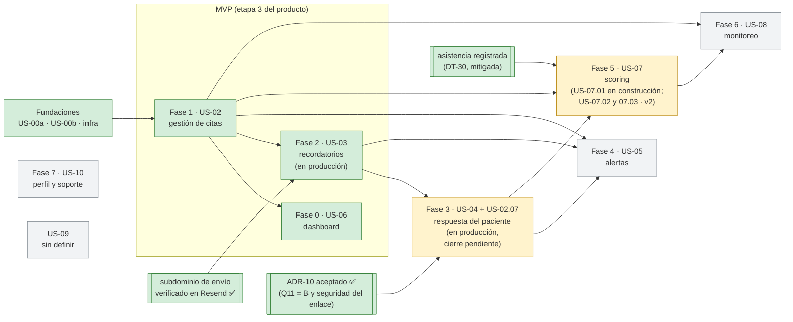

# Fases del roadmap

Puerta de entrada **por fases de construcción**. Cada fase tiene un documento que junta en un solo
lugar todo lo que la toca —ADRs, features, deudas, decisiones del frontend, planes de US, preguntas
abiertas y commits— y dice en qué orden leerlo. Los documentos de origen no se mueven: esta carpeta
es solo navegación, y cada ADR, feature, deuda, US y FD enlaza de vuelta a su fase.

> **Dos sentidos de "fase". Léelo antes de seguir.**
>
> - **Fases del roadmap** (esta carpeta): etapas de **construcción**. Fundaciones, Fase 0 … Fase 7 y
>   US-09. La fuente del estado es [`ROADMAP.md`](../ROADMAP.md).
> - **Etapas del producto** ([`Descripcion/`](../Descripcion/README.md)): cómo se llegó al alcance
>   —problema, validación, requisitos y MVP—. Sus archivos se llaman `fase-0-problema.md` …
>   `fase-3-mvp.md` por historia, pero **no** son fases del roadmap.
> - **Un tercer uso, local a algunos ADR:** ADR-08 divide su plan en "fase 1" (segmento de ruta) y
>   "fase 2" (subdominio); ADR-09 llama "Fase 1" a pedir hora y "Fase 2" al modelo de disponibilidad, y
>   su §7 habla de la "fase 2" del adaptador de hechos. Esas fases son **del ADR**, no del roadmap.
>
> Equivalencia útil: la **etapa 3 del producto (MVP)** son las **fases 0, 1 y 2 del roadmap**.

**Estado al 2026-10-07** (según el [ROADMAP](../ROADMAP.md#resumen)): Fundaciones, Fase 0, Fase 1 y
**Fase 2 cerradas y en producción** —el MVP completo—: release a `main` el 2026-10-06 (backend PR #4,
frontend PR #6) y la Fase 2 cerrada el 2026-10-07 tras la prueba de punta a punta con un correo real
([cierre](fase-2-us03-recordatorios.md#cierre-de-la-fase-2026-10-07)) · **siguiente: Fase 3** (US-04) · el
resto sin empezar.

**2026-10-17:** la **[Fase 3](fase-3-us04-respuesta-paciente.md) está en producción** (backend
[PR #7](https://github.com/Citia-solutions/citia-backend/pull/7), `05bae58`; frontend
[PR #8](https://github.com/Citia-solutions/citia-frontend/pull/8), `1a7f324`), con un corte de ~9 minutos en
el release ([incidente](fase-3-us04-respuesta-paciente.md#incidente-production-caído-9-minutos)). Se cierra
con las pruebas manuales de su [checklist](fase-3-us04-respuesta-paciente.md#checklist-de-salida-a-producción).
Feature: [us04-respuesta-paciente](../Features/us04-respuesta-paciente.md). *(2026-10-15: implementada,
verificada en local y mergeada a `develop` en los dos repos —backend
[PR #6](https://github.com/Citia-solutions/citia-backend/pull/6), frontend
[PR #7](https://github.com/Citia-solutions/citia-frontend/pull/7)—.)*
*(2026-10-14: en construcción; el arquitecto aprobó el diseño —[ADR-10](../Decisions/ADR-10.md) aceptado con
Q11 = B, plan en [US-04](../US/04-respuesta-paciente.md), que absorbe US-02.07—.)*

**2026-10-19:** se reabre la **[Fase 5](fase-5-us07-scoring.md)** por su primera subtarea, **US-07.01 · registro
de hechos** ([plan](../US/07.01-registro-hechos.md)), que entra en construcción **antes que la Fase 4**, de la que
no depende. [ADR-14](../Decisions/ADR-14.md) queda aceptado en lo que toca a US-07.01; US-07.02 (calificación y
riesgo) y US-07.03 (acciones) siguen en la v2, a la espera de la revisión legal.

---

## Índice

Los números de commit remiten a las filas de [`TRAZABILIDAD.md`](../TRAZABILIDAD.md). "Afectadas" =
deudas que la fase cambió de estado sin crearlas ni cerrarlas.

| Fase | US | Estado | Fechas | Features | ADRs | Deudas | FDs | Planes de US | Commits | Depende de |
|---|---|---|---|---|---|---|---|---|---|---|
| [Fundaciones](fase-base-fundaciones.md) | US-00a, US-00b, infraestructura | ✅ cerrada | 2026-06-18 → 2026-06-29 · tooling y ADR-08 el 2026-08-16 | [us00a](../Features/us00a-registro-inicial.md), [us00b](../Features/us00b-login.md), [infra](../Features/infra-contenedores.md) | 00, 01, 02, 03, 05, 06 · 08 (propuesto) | **creadas:** DT-01…09, DT-18, DT-19, DT-21 · **cerradas:** — | — | [US-00](../US/00-auth.md) | filas 1–19 y 26–34 (`258542f` → `bfeada0`) | — |
| [Fase 0](fase-0-us06-dashboard.md) | US-06 dashboard | ✅ cerrada (2026-09-28) | backend 2026-06-30 · zona horaria 2026-07-06 · conexión real 2026-09-28 | [us06](../Features/us06-dashboard-citas.md) | 04, 07 | **creadas:** DT-10…17, DT-20, DT-22 · **cerradas:** — (DT-10 y DT-22 se cierran en la Fase 1) | — | [US-06](../US/06-epic.md) | filas 20–25 y 28 (`9ab2bec` → `08dad63`, `f200557`) | Fundaciones · Fase 1 (lista real, voucher) |
| [Fase 1](fase-1-us02-gestion-citas.md) | US-02 gestión de citas (+ US-02.07 ⏸, 02.08, 02.09) | ✅ cerrada (2026-09-28) | release 1 2026-08-24 · vía pública 2026-09-10 · cierre 2026-09-28 · decisiones 2026-09-29 | [us02](../Features/us02-gestion-citas.md) | 09, 11 · 10 (propuesto, aplazado) · 08 (su fase 1, en la ruta pública) | **creadas:** DT-23…29 · **cerradas:** DT-10, DT-22 · **mitigada:** DT-28 · **afectadas:** DT-12, DT-14, DT-15, DT-18, DT-20 | FD-01 (descartada), FD-02…05 | [US-02.07](../US/02.07-paciente-reagenda-cancela.md), [US-02.08](../US/02.08-voucher-cita.md) | filas 35–39 y 41–58 (`f2a7dff` → `c9ac69f`) | Fundaciones (el ROADMAP no le pone dependencias; reutiliza `Cita` y `Paciente` de la Fase 0) |
| [Fase 2](fase-2-us03-recordatorios.md) | US-03 recordatorios | ✅ **cerrada en producción (2026-10-07)** · **en el MVP** | diseño 2026-09-30 · implementación 2026-10-01 → 2026-10-04 · merge a `develop` 2026-10-04 · release 2026-10-06 · cierre 2026-10-07 | [us03](../Features/us03-recordatorios.md) (nueva) · [us02](../Features/us02-gestion-citas.md), [infra](../Features/infra-contenedores.md) (actualizadas) | 12, 13 · nota en 02 | **creadas:** DT-30, DT-31…DT-39 · DT-40, DT-41 (detectadas en producción) · **cerradas:** DT-21, DT-27 · **mitigada:** DT-30 (2026-10-05) · **verificada, abierta:** DT-19 (falta la fuente de logs) · **afectadas:** DT-11, DT-16, DT-17, DT-20, DT-23, DT-26, DT-29, DT-37 | — | [US-03](../US/03-recordatorios.md) | filas 59, 61–74, 76–84 y 93 (`ab30bb7` → `c057ade`, más el cierre `9fc1ddd` y su merge `72d117f`; la 60 y la 75 son transversales) | Fase 1 · subdominio verificado en Resend ✅ |
| [Fase 3](fase-3-us04-respuesta-paciente.md) | US-04 respuesta del paciente (+ US-02.07, absorbida) | ✅ **en producción (2026-10-17)** · cierre pendiente de las pruebas manuales · fuera del MVP | diseño aprobado 2026-10-14 · implementación 2026-10-14 → 2026-10-15 · verificada en local y mergeada a `develop` 2026-10-15 · release 2026-10-17 | [us04](../Features/us04-respuesta-paciente.md) (nueva) | **10 (aceptado 2026-10-14; notas de implementación 2026-10-15)** · 13 (bloque `accion`, nota en §1) · notas en 04 §4 y 12 §8 (regla G1) | **creadas:** DT-42…DT-45 (previstas el 2026-10-14, abiertas desde el despliegue del 2026-10-17; DT-44 con su parte 2 resuelta; DT-45 con su corrección implementada) · **detectada:** DT-46 · **en producción, se cierra con la prueba de `trust proxy`:** DT-18 · **afectadas:** DT-04, DT-06, DT-11 (regla G1), DT-16, DT-23, DT-26, DT-33, DT-30 (ya mitigada) | FD-06 (resuelta en parte: "cambiar la hora" es una petición manual) | [US-04](../US/04-respuesta-paciente.md) · [US-02.07](../US/02.07-paciente-reagenda-cancela.md) (absorbida) | filas 85–92, 94 y 95 (`c757e0e` → `b93f2c0`, merge `ce0c533`, release `05bae58`) | Fase 2 ✅ · ADR-10 aceptado ✅ |
| [Fase 4](fase-4-us05-alertas.md) | US-05 alertas | ⬜ nada propio (el outbox ya existe, desde la Fase 2) | — | — | 12 §4 (suscriptores) · 09 §7 | **afectada:** DT-28 | — | — | — | Fases 1, 2 y 3 |
| [Fase 5](fase-5-us07-scoring.md) | US-07 scoring: US-07.01 registro de hechos · US-07.02 calificación y riesgo · US-07.03 acciones | 🔶 **US-07.01 en construcción (2026-10-19)** · US-07.02 y US-07.03 ⏸ v2 (fuera del MVP) | salida del MVP 2026-09-30 · diseño (ADR-14) y US-07.01 desde 2026-10-19 | — | **14 (aceptado en lo que toca a US-07.01, 2026-10-19; el resto propuesto)** · 04 §2 (extendido por 14) y §4 · 12 §8 | **implementa:** DT-11 (se cierra al prender el job G1 en production) · **afectadas:** DT-13, DT-23, DT-30, DT-37, DT-40, DT-44 | — | [US-07.01](../US/07.01-registro-hechos.md) | — | Fases 1 y 3 · proceso de cierre (ADR-12) · DT-30 · *US-07.01 no depende de la Fase 4* |
| [Fase 6](fases-6-7-us09-sin-diseno.md#fase-6--us-08-monitoreo-y-seguimiento-del-paciente) | US-08 monitoreo | 🔶 solo `POST /pacientes` (+ `PATCH /pacientes/:id` en la Fase 2) | — | — | — | — | — | — | — | Fases 1 y 5 |
| [Fase 7](fases-6-7-us09-sin-diseno.md#fase-7--us-10-perfil-suscripción-y-soporte) | US-10 perfil y soporte | ⬜ | — | — | — | — | — | — | — | — |
| [US-09](fases-6-7-us09-sin-diseno.md#us-09--sin-definir) | sin definir | ⬜ | — | — | — | — | — | — | — | — |

Las filas 40 (`cea0bd1`, creación del ROADMAP), 60 (`2f33394`, navegación por fases) y 75 (`f1f711f`,
primer release a `main`) de la trazabilidad son **transversales**: no pertenecen a una fase.

---

## Dependencias entre fases

Solo las aristas que declara el [ROADMAP](../ROADMAP.md#resumen) (más Fundaciones como base). En
rectángulo doble, los prerrequisitos que no son fases.

**Cómo leer el diagrama.** Verde = cerrada; desde el 2026-10-07 las tres fases del MVP (0, 1 y 2) están
además **en producción**, el subdominio de envío, el prerrequisito de la Fase 2, quedó verificado, y desde el 2026-10-05 la asistencia se registra en el voucher (DT-30 mitigada). Amarillo =
en curso (la Fase 3: en construcción desde el 2026-10-14, con ADR-10 ya aceptado; mergeada a `develop` el
2026-10-15 y **en producción desde el 2026-10-17**, sin cerrar hasta sus pruebas manuales; y, desde el
2026-10-19, la Fase 5 por US-07.01, que se construye antes que la Fase 4 porque no depende de ella: no hay arista
F4 → F5); gris = pendiente; lila = aplazada a la v2 (hasta el 2026-10-19 lo era la Fase 5 entera; desde
entonces solo US-07.02 y US-07.03, que comparten su nodo). La Fase 0 depende de la Fase 1 aunque se construyó primero: su backend
(junio) creó `Cita`, `Paciente` y `POST /citas`, pero el dashboard solo quedó cerrado cuando la
Fase 1 entregó la lista real, el voucher (US-02.08) y el refresco tras cada cambio (US-02.09). La
Fase 7 y US-09 no dependen de nada según el ROADMAP. La Fase 6 depende de US-07 (la Fase 5), no de
la subtarea US-02.07.

---

## Qué no pertenece a ninguna fase

| Documento | Por qué es transversal |
|---|---|
| [`rf.md`](../rf.md) · [`rnf.md`](../rnf.md) | requisitos; cada fase cita los suyos |
| [`rules.md`](../rules.md) · [ADR-02](../Decisions/ADR-02.md) | reglas de código que aplican a todas |
| [`stack-tecnologico.md`](../stack-tecnologico.md) | stack y despliegue; la Fase 2 lo actualizó el 2026-09-30, el 2026-10-04 (dependencias instaladas) y el 2026-10-07 (infraestructura en producción y mapa de entornos) |
| [`PREGUNTAS-ABIERTAS.md`](../PREGUNTAS-ABIERTAS.md) | Q2 (prepago), Q3 (agenda de la organización) y Q10 (validación) no son de ninguna fase |
| [`Descripcion/`](../Descripcion/README.md) | etapas del producto (ver arriba) |

---

## Convenciones de esta carpeta

- **Un documento por fase** con el nombre `fase-<n>-<us>-<tema>.md`; `fase-base-` para Fundaciones.
  Las fases 6, 7 y US-09 comparten [un documento](fases-6-7-us09-sin-diseno.md) porque no tienen ADR,
  FD, plan, feature ni commit propios; cuando alguna los tenga, se separa en su archivo.
- **El estado vive en el ROADMAP**, no aquí. Si un documento de fase contradice al ROADMAP, manda el
  ROADMAP y hay que corregir la fase.
- **Bloque de navegación.** Cada ADR, feature, deuda, US y FD lleva bajo el título una línea
  `**Fase:** … · **Feature:** … · **Plan:** … · **Relacionado:** …`. Al crear un documento nuevo,
  agrégala y suma el documento a la sección correspondiente de su fase.
