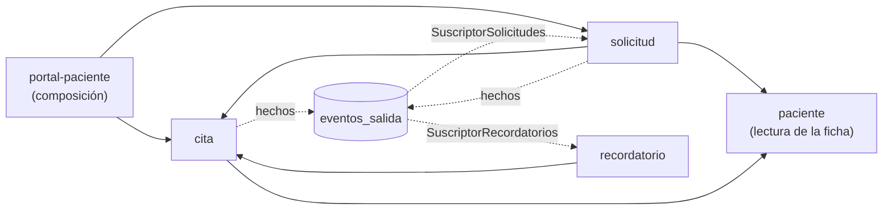
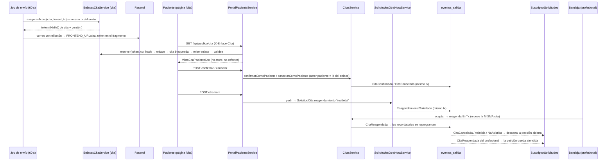

# Feature: US-04 — El paciente responde desde el enlace del recordatorio (+ US-02.07 y límite de tasa)

> **Fase:** [Fase 3 — US-04](../Fases/fase-3-us04-respuesta-paciente.md) · **Feature:** este documento · **Plan:** [US-04](../US/04-respuesta-paciente.md) (absorbe [US-02.07](../US/02.07-paciente-reagenda-cancela.md)) · **Relacionado:** [ADR-10](../Decisions/ADR-10.md), [ADR-13](../Decisions/ADR-13.md), [ADR-12](../Decisions/ADR-12.md), [ADR-09](../Decisions/ADR-09.md), [ADR-04](../Decisions/ADR-04.md), [DT-18](../Deudas/DT-18.md), [DT-42](../Deudas/DT-42.md)…[DT-46](../Deudas/DT-46.md), [DT-11](../Deudas/DT-11.md), [responder-cita-paciente (front)](../../../citia-frontend/context/Features/responder-cita-paciente.md)

**Historia:** US-04 (RF-07) + subtarea US-02.07 · requisitos de seguridad S1–S3 y límite de tasa L1–L3 de ADR-10
**Estado:** ✅ **en producción (2026-10-17)** · mergeada a `develop` el 2026-10-15 (backend
[PR #6](https://github.com/Citia-solutions/citia-backend/pull/6), frontend
[PR #7](https://github.com/Citia-solutions/citia-frontend/pull/7)) y desplegada el 2026-10-17 (backend
[PR #7](https://github.com/Citia-solutions/citia-backend/pull/7), frontend
[PR #8](https://github.com/Citia-solutions/citia-frontend/pull/8)); lo que queda, en el
[checklist de la fase](../Fases/fase-3-us04-respuesta-paciente.md#checklist-de-salida-a-producción)
**Pruebas:** 1709 unitarios (95 suites), 287 e2e (15 suites) y 139 de integración (8 suites) en verde ·
cobertura global 84 % de líneas
**Commits:** `c757e0e` (infra y límite de tasa), `6fbf4e3` (persistencia), `4d3d88f` (enlace y actor),
`5f8ac6d` (recordatorio), `92b8020` (pedir otra hora y suscriptor), `143c8fb` (`portal-paciente`), `3b312f9`
(e2e), `b93f2c0` (docs) · merge `ce0c533` a `develop` (PR #6) · release `05bae58` (PR #7) · filas 85–92, 94 y
95 de la [TRAZABILIDAD](../TRAZABILIDAD.md)
**ADRs:** **[10](../Decisions/ADR-10.md)** (aceptado el 2026-10-14; [notas de implementación](../Decisions/ADR-10.md#notas-de-implementación-2026-10-15)) ·
nota en [13 §1](../Decisions/ADR-13.md) (el recordatorio pide el enlace a `cita`) · se apoya en
[12 §4](../Decisions/ADR-12.md) (suscriptor nuevo), [09](../Decisions/ADR-09.md) (bandeja),
[04](../Decisions/ADR-04.md) (grafo de estados, regla G1), [06](../Decisions/ADR-06.md) (transacción),
[02](../Decisions/ADR-02.md) (capas)

> El porqué de cada decisión está en ADR-10; el contrato (decisiones S/E/R/G/L), en el plan US-04. Este
> documento describe **lo que existe en el código** y, en
> [Desviaciones del contrato](#desviaciones-del-contrato-y-decisiones-tomadas-al-implementar), dónde se
> apartó de él. Las reglas locales para los agentes viven en los `CLAUDE.md` de `portal-paciente`, `cita`,
> `solicitud` y `recordatorio`.

---

## Qué hace

> *Como paciente quiero confirmar, cancelar o pedir otra hora desde el correo del recordatorio, sin cuenta
> y sin llamar, para avisar a tiempo.*
> *Como profesional quiero saber quién confirmó o canceló cada cita, atender las peticiones de otra hora en
> mi bandeja y poder invalidar el enlace si llegó a quien no era.*

- **Cada recordatorio lleva un botón fijo**, *Ver o responder mi hora*, que abre `${FRONTEND_URL}/cita#<token>`.
  Todos los recordatorios de una cita llevan **el mismo enlace**; nace al enviar el primero.
- La página del paciente (frontend, ruta `/cita`) muestra fecha y hora en la zona de la clínica, duración,
  estado, profesional y organización. **Nunca** el nombre del paciente, su RUT, su contacto, el tipo de
  consulta ni ids internos.
- **Abrir la página no cambia nada.** Las tres acciones son botones (un `POST` cada una):
  - **Confirmar** — `pendiente → confirmada`, con el paciente como actor en la bitácora.
  - **Cancelar** — con motivo opcional; la cita queda `cancelada` y el enlace deja de servir.
  - **Pedir otra hora** — una preferencia obligatoria y un motivo opcional. **La cita no se mueve**: entra
    a la bandeja como una solicitud de tipo `reagendamiento`; al aceptarla, el profesional **mueve la
    misma cita** (mismo id, vuelve a `pendiente`, los recordatorios se reprograman y el mismo enlace sirve
    para la hora nueva).
- El enlace vale mientras la cita esté vigente y **antes de su `inicio`**; después, o con la cita cerrada, o
  invalidado, responde *"Enlace no válido o vencido"* (el mismo 404 en todos los casos).
- En el **voucher**, el profesional ve quién confirmó o canceló (`confirmadaPor` / `canceladaPor`), la nota
  *"El paciente pidió otra hora"* y el botón *Invalidar enlace del paciente*.
- Nace el **límite de tasa** en las cuatro superficies públicas: el enlace del paciente, el login, el
  registro y la solicitud pública de hora (cierra en código [DT-18](../Deudas/DT-18.md)).

---

## Arquitectura (hexagonal)

### Módulo nuevo `portal-paciente/` (composición)

```
src/modules/portal-paciente/
├── domain/                                   ← puro (src/arquitectura.spec.ts lo vigila)
│   ├── acciones-paciente.ts                  ← AccionPaciente + accionesPermitidasPaciente(cita, hayPeticion, ahora)
│   └── lector-nombres-cita.ts                ← puerto de SOLO LECTURA: nombre del profesional y de la organización
├── application/
│   ├── portal-paciente.service.ts            ← ver / confirmar / cancelar / pedirOtraHora: UNA transacción cada una
│   └── accion-no-disponible.error.ts         ← → 409 uniforme
├── infrastructure/persistence/
│   └── sql-lector-nombres-cita.ts            ← una consulta (usuarios ⨝ tenants), filtra por tenant
├── presentation/
│   ├── portal-paciente.controller.ts         ← `publico/cita`, SIN JWT; cuerpos de error fijos
│   └── dto/                                  ← VistaCitaPacienteDto, CancelarCitaPacienteDto, PedirOtraHoraDto, @Recortar
├── integration/portal-paciente-concurrencia.integration.spec.ts
├── portal-paciente.module.ts                 ← importa SharedModule, CitaModule, SolicitudModule
└── CLAUDE.md
```

No tiene reglas de negocio propias salvo `accionesPermitidasPaciente`, que toma las guardas de estado de
`Cita.accionesPermitidas()` (única fuente del grafo, ADR-04 §1) y suma las del paciente: nada si
`ahora ≥ inicio`, y sin `confirmar` ni `pedirOtraHora` con una petición abierta (R6).

### Lo que cambia en los módulos existentes

| Módulo | Qué se agrega |
|---|---|
| `cita` | `domain/enlace-cita.entity.ts` (`emitir`, `siguienteVersion`, `invalidar`, `permiteActuarSobre`) · `domain/actor.ts` (`profesional` \| `paciente` \| `sistema`) · puerto `DerivadorTokenEnlace` + `esFormatoTokenEnlace` · puerto `EnlaceCitaRepository` · `application/enlaces-cita.service.ts` (`asegurarActivo`, `resolver`, `invalidar`) · `CitasService`: un solo esqueleto de mutación (`aplicar`) con actor, `confirmarComoPaciente`, `cancelarComoPaciente`, `reagendarEnTx`, `resumenesPorIds` · `CitaRepository.buscarPorIds` y carga con bloqueo `FOR NO KEY UPDATE` · `infrastructure/seguridad/` (HMAC con `node:crypto`, lectura de la clave) · ruta `POST /citas/:id/enlace/invalidar` · `confirmadaPor` / `canceladaPor` en el detalle |
| `solicitud` | `TipoSolicitud` (`nueva` \| `reagendamiento`), `citaOrigenId`, `enlaceId`, estado `descartada` · fábrica `pedirOtraHora` y `descartar` · `application/solicitudes-otra-hora.service.ts` (**exportado** al portal) · `application/suscriptor-solicitudes.ts` (outbox) · aceptar con rama de reagendamiento · listar con `citaOrigenId` y `citaOrigen` · `ReagendamientoYaSolicitadoError` (23505 → 409) · importa `PacienteModule` (lee la ficha) |
| `recordatorio` | importa `CitaModule` **solo** para el enlace; en `application/` lo ve como el puerto `EmisorEnlaceCita` · `enviar()` llama `asegurarActivo` en su transacción y llena el bloque `accion` de la plantilla |
| `shared` | `limite-tasa.module.ts` (guard global) · `presentation/limitar-tasa.decorator.ts` (`@LimitarTasa`, tabla `LIMITES_TASA`) · `infrastructure/limite-tasa/opciones-limite-tasa.ts` · `presentation/sin-cache-ni-referrer.interceptor.ts` (`@SinCacheNiReferrer`) · `presentation/cabecera-enlace-cita.ts` · `ENLACE_CITA_CLAVE` y `LIMITE_TASA_ACTIVO` en `entorno.ts` · CORS con lista explícita de cabeceras · pino redacta `x-enlace-cita`, `tokenHash` y `token_hash` |
| `auth`, `usuario`, `solicitud` (pública) | `@LimitarTasa('login')`, `@LimitarTasa('registro')`, `@LimitarTasa('solicitudPublica')` |
| `main.ts` | `app.set('trust proxy', 1)` |

### Reglas de dependencia



- **`cita` no importa `solicitud`, `recordatorio` ni `portal-paciente`.** `solicitud` se entera de lo que
  le pasa a la cita por el **outbox** (`SuscriptorSolicitudes`), nunca por import. Nadie importa
  `PortalPacienteModule` ni `RecordatorioModule` (solo `AppModule`).
- **`recordatorio` sigue sin escribir tablas ajenas con su SQL:** la fila de `enlaces_cita` la escribe
  `cita` (`asegurarActivo`), dentro de la transacción del envío.
- **Los nombres** del profesional y de la organización los lee el portal con su propio lector SQL de solo
  lectura (`SqlLectorNombresCita`), sin ampliar la superficie de `usuario` ni `tenant`. Coste aceptado:
  depende del esquema de `usuarios.nombre_completo` y `tenants.nombre`.
- **Ninguna ruta pública acepta ids del cliente:** todo es `token → enlace → cita → tenant`.

### Orden de bloqueo (sin interbloqueos)

| Quién | Bloquea, en este orden |
|---|---|
| Profesional (voucher), paciente (portal), invalidar, autocorrección de la clave | la **cita** (`FOR NO KEY UPDATE`) → después lee o modifica su enlace |
| Portal | la **cita** → **lee sin bloqueo** la petición de otra hora |
| Bandeja (aceptar / rechazar) | la **solicitud** (`FOR UPDATE`) → después la cita (`reagendarEnTx`) |
| `SuscriptorSolicitudes` | **solo** la solicitud (`FOR UPDATE`), nunca la cita |

Nadie toma solicitud y cita en el orden inverso al de la bandeja. Por eso el portal **no** descarta la
petición abierta al cancelar: lo hace el suscriptor, segundos después ([DT-33](../Deudas/DT-33.md)).

---

## Flujo de punta a punta



1. **El enlace nace con el primer envío.** El job de envío del recordatorio, tras sus nueve políticas y
   solo si de verdad va a enviar, llama `asegurarActivo` **en su misma transacción**: si la cita ya tiene un
   enlace activo, usa ese; si no, inserta `max(version) + 1` con `INSERT … ON CONFLICT DO NOTHING` y relee
   (dos envíos a la vez terminan con un enlace y el mismo token). El token se **recalcula** con
   `base64url(HMAC-SHA256(ENLACE_CITA_CLAVE, "enlace-cita:<cita>:<versión>"))` (43 caracteres); en la base
   solo está su `sha256` en hex. La plantilla lleva el botón fijo y sigue siendo **determinista entre
   reintentos** (mismo enlace → mismo token → mismo HTML, como exige la `Idempotency-Key`). Si
   `asegurarActivo` lanza, el envío es un **error interno** con reintento: nunca sale un correo sin enlace.
2. **El paciente abre la página.** El frontend lee el fragmento, lo borra de la URL y llama
   `GET /api/publico/cita` con la cabecera `X-Enlace-Cita`. El token nunca va en la URL de la API.
3. **Cada petición del portal es una transacción**, siempre en este orden: `resolver` (formato inválido →
   nada sin tocar la base; enlace por hash; **cita bloqueada** con el id y el tenant del enlace; **relee** el
   enlace, por si una invalidación concurrente ya confirmó) → validez con el reloj del portal → la petición de
   otra hora abierta, **sin bloqueo** → `accionesPermitidasPaciente` (409 si la acción no está) → la acción →
   la vista resultante.
4. **Confirmar y cancelar** usan el mismo esqueleto de mutación que el profesional (`aplicar`: dominio →
   guardar → bitácora → hecho, todo en el tx), con actor `paciente` (`actor_id` = id del enlace).
   `confirmarComoPaciente` y `cancelarComoPaciente` repiten la validez del enlace con un reloj nuevo
   (defensa en profundidad). Tras cancelar, la respuesta trae la vista `cancelada` sin acciones; un `GET`
   posterior ya responde 404.
5. **Pedir otra hora** crea una `SolicitudCita` de tipo `reagendamiento`, `recibida`, con `citaOrigenId`,
   `enlaceId`, `usuarioId` = **dueño de la cita** y los datos del paciente **copiados de su ficha** (RUT y
   correo pueden faltar), y publica `ReagendamientoSolicitado`. La cita no cambia (R1); desde ese momento el
   enlace **solo permite cancelar** (R6). Una segunda petición, también si gana la carrera la otra (23505
   del índice único parcial), → 409.
6. **La bandeja** muestra la petición como *"Pide otra hora"* con su cita de origen. **Aceptar** pide solo
   `inicio`, bloquea la solicitud y mueve la cita con `reagendarEnTx` en la misma transacción (mismo id,
   vuelve a `pendiente`, bitácora del profesional, `CitaReagendada`); `solicitud.citaId = citaOrigenId`. El
   suscriptor de recordatorios reprograma los correos y **el mismo enlace sirve para la hora nueva** (la
   validez usa el `inicio` vigente). **Rechazar** no toca la cita y no avisa al paciente
   ([DT-44](../Deudas/DT-44.md), parte 1); la página vuelve a ofrecer todas las acciones.
7. **El suscriptor** `SuscriptorSolicitudes` mantiene coherente la petición con su cita (ver
   [Hechos y suscriptor](#hechos-y-suscriptor)).
8. **Invalidar** desde el voucher revoca el enlace activo (`revocado_por` = usuario); el enlace del correo
   anterior responde 404 y el **siguiente recordatorio** emite la versión siguiente con otro token.

### Validez del enlace

`EnlaceCita.permiteActuarSobre(cita, ahora)`, evaluada **dentro** de la transacción de la acción:

- el enlace no está revocado;
- es de **esa** cita y del mismo tenant;
- la cita está vigente (`pendiente` | `confirmada`): una cita terminal invalida el enlace **sin** revocarlo;
- `ahora < inicio` **vigente** (si se reagendó, cuenta la hora nueva). Sin tope de días.

### Acciones permitidas al paciente

Calculadas en el backend sobre la cita bloqueada; con `ahora ≥ inicio`, ninguna.

| Estado de la cita | Sin petición abierta | Con petición de otra hora abierta |
|---|---|---|
| `pendiente` | `confirmar`, `cancelar`, `pedirOtraHora` | `cancelar` |
| `confirmada` | `cancelar`, `pedirOtraHora` | `cancelar` |
| terminal (`cancelada`, `asistio`, `no_asistio`, `ghosting`) | — (el enlace da 404) | — |

---

## Endpoints

Prefijo global `/api`. El `ValidationPipe` global (`whitelist`, `transform`) corre **antes** del
controller: un cuerpo inválido da 400 sin mirar el token.

| Método | Ruta | Guard | Límite de tasa | Respuestas |
|---|---|---|---|---|
| `GET` | `/api/publico/cita` | — (token en `X-Enlace-Cita`) | 30/min por IP | 200 · 404 · 429 |
| `POST` | `/api/publico/cita/confirmar` | ídem | 30/min por IP + 5/h por enlace | 200 · 404 · 409 · 429 |
| `POST` | `/api/publico/cita/cancelar` | ídem | ídem | 200 · 400 · 404 · 409 · 429 |
| `POST` | `/api/publico/cita/otra-hora` | ídem | ídem | **201** · 400 · 404 · 409 · 429 |
| `POST` | `/api/citas/:id/enlace/invalidar` | JWT | — | **204** · 400 (no UUID) · 401 · 404 |
| `GET` | `/api/citas/:id` | JWT | — | **cambia (aditivo):** `confirmadaPor`, `canceladaPor` |
| `GET` | `/api/solicitudes?estado=&citaOrigenId=` | JWT | — | **cambia (aditivo):** filtro `citaOrigenId`, estado `descartada`, campos `tipo`, `citaOrigenId`, `citaOrigen` |
| `POST` | `/api/solicitudes/:id/aceptar` | JWT | — | **cambia:** `duracionMin` y `tipoConsulta` opcionales; rama de reagendamiento |
| `POST` | `/api/auth/login` | — | **nuevo:** 5/min por IP | + 429 |
| `POST` | `/api/usuarios` (registro) | — | **nuevo:** 5/h por IP | + 429 |
| `POST` | `/api/publico/:tenantSlug/solicitudes` | — | **nuevo:** 5/h por IP (un contador para todas las organizaciones) | + 429 |

### Portal del paciente: `/api/publico/cita`

Todas las rutas: cabecera obligatoria `X-Enlace-Cita: <token>`; respuestas con `Cache-Control: no-store` y
`Referrer-Policy: no-referrer`, **también en los errores** 400, 404 y 409 (el interceptor pone las
cabeceras antes de ejecutar la ruta).

**`GET /api/publico/cita` → 200 `VistaCitaPacienteDto`.** Solo lee: abrirla N veces no cambia la cita, la
bitácora ni el outbox.

```json
{
  "inicio": "2026-10-20T13:30:00.000Z",
  "zonaHoraria": "America/Santiago",
  "duracionMin": 45,
  "estado": "pendiente",
  "profesional": "Ana Soto",
  "organizacion": "Centro Médico Demo",
  "accionesPermitidas": ["confirmar", "cancelar", "pedirOtraHora"],
  "solicitudOtraHora": null
}
```

- `zonaHoraria` = `APP_TZ`; `profesional` = nombre completo del **dueño** de la cita; `organizacion` = nombre
  del tenant.
- Con una petición abierta: `"accionesPermitidas": ["cancelar"]` y
  `"solicitudOtraHora": { "preferencia": "martes en la tarde", "solicitadaEn": "2026-10-15T14:02:11.000Z" }`.
- **Nunca** trae nombre del paciente, RUT, teléfono, correo, `tipoConsulta`, ids (cita, enlace, tenant,
  profesional, solicitud) ni el token.

**`POST /api/publico/cita/confirmar`** (sin cuerpo) → 200 con la vista `confirmada`.

**`POST /api/publico/cita/cancelar`** `{ "motivo"?: string ≤ 300 }` → 200 con la vista `cancelada`, sin
acciones y `solicitudOtraHora: null`. El motivo se recorta; en blanco cuenta como ausente; queda en la
bitácora.

**`POST /api/publico/cita/otra-hora`** `{ "preferencia": string 1..300, "motivo"?: string ≤ 300 }` → **201**
con la vista (petición abierta, solo `cancelar`). Los textos se recortan antes de validar: una preferencia
solo con espacios es vacía (400).

| Caso | Respuesta (cuerpo **exacto**) |
|---|---|
| Enlace no válido: cabecera ausente, formato incorrecto, inexistente, revocado, cita terminal o `ahora ≥ inicio` | `404 { "statusCode": 404, "message": "Enlace no válido o vencido" }` — idéntico en las cuatro rutas |
| Enlace válido, acción no permitida (confirmar una confirmada, confirmar o pedir otra hora con una petición abierta), transición rechazada por la entidad, o carrera perdida con otra petición de otra hora | `409 { "statusCode": 409, "message": "Esta acción ya no está disponible" }` |
| Cuerpo inválido | 400 del `ValidationPipe` (antes de mirar el token: no revela nada del enlace) |
| Límite de tasa superado | `429 { "statusCode": 429, "message": "Demasiados intentos, prueba en unos minutos" }`, sin `Retry-After` ni `X-RateLimit-*` |
| Cualquier otro error | 500 genérico de Nest, sin detalles |

### `POST /api/citas/:id/enlace/invalidar`

JWT; la cita se busca por id y **tenant del token**. **204** sin cuerpo: revoca el enlace activo
(`motivo_revocacion = invalidado`, `revocado_por` = usuario del token). Sin enlace activo, **204** igual
(idempotente). Otro tenant o inexistente → **404** idéntico, y el enlace ajeno sigue activo. No existe ruta
para ver ni copiar el enlace (E4).

### `GET /api/citas/:id` — `confirmadaPor` y `canceladaPor` (aditivo)

`'paciente' | 'profesional' | 'sistema' | null`, del **último** cambio `confirmada` / `cancelada` de la
bitácora. `confirmadaPor` solo cuenta con estado `confirmada`, `asistio` o `no_asistio` (tras reagendar, la
cita vuelve a `pendiente` y una confirmación vieja deja de contar); `canceladaPor`, solo con `cancelada`. En
otro caso, `null`. `GET /api/citas/hoy` y `CitaDashboardDto` **no cambian**.

### `GET /api/solicitudes?estado=&citaOrigenId=` (aditivo)

- `estado` admite además `descartada`; sin `estado`, `recibida` (tope 100, como antes).
- `citaOrigenId` (UUID, opcional): solo las de reagendamiento de esa cita. El voucher pregunta
  `?citaOrigenId=<id>&estado=recibida` para la nota *"El paciente pidió otra hora"*. Otro tenant → `[]`; no
  UUID → 400.
- `SolicitudBandejaDto` suma `tipo` (`nueva` | `reagendamiento`), `citaOrigenId` y
  `citaOrigen: { inicio, duracionMin, estado } | null` (la cita de origen **tal como está ahora**, en una
  lectura por lote, sin N+1). En una de reagendamiento `rut` y `correo` pueden ser `null` y `motivo`, `''`.
  Nunca `tenantId`, `usuarioId` ni `enlaceId`.

### `POST /api/solicitudes/:id/aceptar` (rama de reagendamiento)

Cuerpo `{ inicio, duracionMin?, tipoConsulta? }` (`inicio` con zona explícita).

| Tipo | Qué hace | `cita` en la respuesta `201 { solicitud, cita }` |
|---|---|---|
| `nueva` | como en la Fase 1: crea paciente (o vincula por RUT) y cita. Sin `duracionMin` o `tipoConsulta` → **400** *"Para aceptar una solicitud nueva, duracionMin y tipoConsulta son obligatorios"* | la de `POST /citas` (con `paciente` y `avisos`) |
| `reagendamiento` | **mueve la cita de origen** a `inicio` (lo demás se ignora); `solicitud.citaId = citaOrigenId`. Cita de origen terminal → **409**; inexistente → 404 | la de `PATCH /citas/:id/reagendar` (con `avisos`, **sin** `paciente`) |

Rechazar (`POST /api/solicitudes/:id/rechazar`) no cambia: en una de reagendamiento, la cita queda como
estaba.

---

## Esquema de BD

Tres migraciones nuevas, con `down` que **se niega a perder datos** que el esquema anterior no puede
representar. TypeORM corre todas las pendientes en una transacción (`migrationsTransactionMode = 'all'`):
probado en `src/database/integration/migraciones-fase3.integration.spec.ts`.

### `enlaces_cita` — `1750000012000-CreateEnlacesCita` (módulo `cita`)

| Columna | Tipo | Notas |
|---|---|---|
| `id` | `uuid` PK | es el `actor_id` del paciente en `cambios_cita` |
| `cita_id` | `uuid` NOT NULL | FK a `citas` (`ON DELETE RESTRICT`, `ON UPDATE CASCADE`) |
| `tenant_id` | `uuid` NOT NULL | sin FK (el de su cita) |
| `version` | `int` NOT NULL | ≥ 1 (CHECK) |
| `token_hash` | `char(64)` NOT NULL | SHA-256 hex del token; CHECK `^[0-9a-f]{64}$` (impide guardar el token en claro) |
| `emitido_en` | `timestamptz` default `now()` | |
| `revocado_en` · `motivo_revocacion` · `revocado_por` | `timestamptz` · `varchar` · `uuid`, null | CHECK de coherencia: activo sin datos de revocación; revocado con motivo `invalidado`; `revocado_por` nulo = revocación del **sistema** (la autocorrección de la clave) |

| Índice | Para qué |
|---|---|
| `uq_enlace_cita_token_hash` UNIQUE `(token_hash)` | `resolver` por hash |
| `uq_enlace_cita_version` UNIQUE `(cita_id, version)` | una fila por versión; con el token determinista, hace idempotente `asegurarActivo` |
| `uq_enlace_cita_activo` UNIQUE `(cita_id) WHERE revocado_en IS NULL` | **un enlace activo por cita** (E1); destino del `ON CONFLICT DO NOTHING` |

⚠️ El `down` borra la tabla: los enlaces enviados dejan de resolver y el `actor_id` de las respuestas del
paciente en `cambios_cita` queda apuntando a nada (no hay FK).

### `solicitudes_cita` — `1750000013000` y `1750000014000` (módulo `solicitud`)

- **`1750000013000-AddDescartadaAEstadoSolicitudesCita`:** `ALTER TYPE enum_solicitudes_cita_estado ADD VALUE
  'descartada'`. Va sola porque un valor agregado en una transacción no se puede **usar** hasta el commit;
  ninguna migración del lote lo usa. ⚠️ Si una futura migración necesita usar `'descartada'` y puede correr
  en el mismo lote, hay que correr con `--transaction each`. El `down` recrea el tipo y falla si hay filas
  `descartada`.
- **`1750000014000-AddReagendamientoASolicitudesCita`:**
  - `tipo` enum `nueva | reagendamiento` NOT NULL DEFAULT `nueva` (las filas existentes quedan `nueva`);
  - `cita_origen_id` y `enlace_id` `uuid` null, **sin FK** (como `cita_id`, ADR-09);
  - `rut` y `correo` pasan a NULL;
  - CHECK `CHK_solicitudes_cita_reagendamiento_origen`: `reagendamiento` ⇒ `cita_origen_id` no nulo;
  - CHECK `CHK_solicitudes_cita_nueva_datos` (aditivo, fuera del contrato): una `nueva` sigue exigiendo
    `rut` y `correo`;
  - `uq_solicitud_reagendamiento_recibida` UNIQUE `(cita_origen_id) WHERE tipo = 'reagendamiento' AND
    estado = 'recibida'` (R5);
  - `idx_solicitud_tenant_cita_origen (tenant_id, cita_origen_id)` para el filtro del voucher.
  - El `down` falla si hay solicitudes de reagendamiento.

`cambios_cita`: **sin cambios** de esquema; `enum_cambios_cita_actor` ya tenía `profesional`, `paciente` y
`sistema`. `citas`, `pacientes`, `usuarios`, `tenants`: sin cambios.

---

## Hechos y suscriptor

**Todos los hechos de cita** (`CitaCreada`, `CitaConfirmada`, `CitaCancelada`, `CitaAsistida`,
`CitaNoAsistida`, `CitaReagendada`, `CitaEditada`) llevan ahora `actor: { tipo, id }` (`id` = usuario,
enlace o `null` para `sistema`), y su `usuarioId` es el **dueño** de la cita (`cita.usuarioId`), no quien
hizo la petición. Payload: `citaId`, `pacienteId`, `usuarioId`, `estado`, `inicio`, `inicioAnterior`,
`actor`. Nunca el token, su hash, datos del paciente ni el motivo.

**Hecho nuevo `ReagendamientoSolicitado`** (al pedir otra hora, mismo tx):
`{ citaId, usuarioId (dueño), solicitudId, actor: { tipo: 'paciente', id: enlaceId } }`. Hoy nadie lo
escucha; lo usarán las alertas de la Fase 4 ([DT-43](../Deudas/DT-43.md)).

**`SuscriptorSolicitudes`** (módulo `solicitud`, ADR-12 §4):

| Hecho | Efecto sobre la petición de otra hora `recibida` de esa cita |
|---|---|
| `CitaCancelada`, `CitaAsistida`, `CitaNoAsistida` | `descartada` (`resueltaEn` = ahora); la pone el sistema |
| `CitaReagendada` con `actor.tipo = 'profesional'` y la petición recibida **antes** del reagendamiento (`recibidaEn ≤ ocurridoEn`) | **atendida** = `aceptada`, con `usuarioId` = quien reagendó y `citaId` = la cita |
| `CitaReagendada` del paciente, del sistema o sin actor; o una petición recibida **después** | nada (la decide la bandeja) |

Idempotente (busca solo `recibida`, con `FOR UPDATE`), bloquea **solo** la solicitud, sin efectos externos
ni logs con datos del paciente. Un hecho sin `tenantId`, `citaId`, `actor.id` (si es del profesional) u
`ocurridoEn` válido lanza `EventoSolicitudInvalidoError` (nombra el campo, nunca el valor) → reintentos →
carta muerta con alerta. Si la bandeja aceptó la petición, ya está `aceptada` en el mismo tx que publicó
`CitaReagendada`: el suscriptor no encuentra ninguna abierta.

Los recordatorios no cambian de regla: `SuscriptorRecordatorios` reprograma con `CitaReagendada` y anula con
los terminales, también cuando el actor es el paciente.

---

## Seguridad y privacidad

| Requisito (ADR-10) | Cómo se cumple |
|---|---|
| El token es una credencial | En el **fragmento** de la página (`/cita#<token>`) y en la cabecera `X-Enlace-Cita` hacia la API; nunca en la URL de la API, en logs (pino redacta la cabecera y los campos `token`, `tokenHash`, `token_hash`), en hechos del outbox ni en mensajes de error. En la base solo su SHA-256 |
| Un volcado de la base no abre enlaces | El token sale de un HMAC con `ENLACE_CITA_CLAVE`, que no está en la base |
| **S1** — invalidar | `POST /api/citas/:id/enlace/invalidar` sube la versión; el anterior responde 404 |
| **S2** — lo mínimo | `VistaCitaPacienteDto` sin datos del paciente, `tipoConsulta` ni ids (test sobre las claves del JSON) |
| **S3** — transporte | `no-store` y `no-referrer` en las respuestas del portal; en el frontend, `history.replaceState` (vía `router.replace`), sin scripts de terceros y `public/_headers` con `Referrer-Policy: no-referrer` y `X-Robots-Tag: noindex, nofollow` para `/cita` |
| Abrir nunca ejecuta | El `GET` solo lee; toda acción es un `POST` tras un clic |
| Respuesta uniforme | El mismo 404 para las seis formas de enlace no válido; el mismo 409 para toda acción no disponible |
| Aislamiento | Ninguna ruta pública acepta ids; el enlace solo ve y actúa sobre su cita (probado entre citas y entre tenants) |
| Nada después de `inicio` | En el dominio (`permiteActuarSobre`), dentro del tx; confirmar y cancelar lo repiten con un reloj nuevo |
| CORS | Lista **explícita** de cabeceras permitidas: `content-type`, `authorization`, `x-request-id`, `x-enlace-cita`. Antes se reflejaba cualquier cabecera pedida: una cabecera nueva del frontend hay que sumarla en `origenes-cors.ts` |

### Límite de tasa

`@nestjs/throttler` con almacén **en memoria** (válido con **una réplica** en Railway). `LimiteTasaModule`
registra un `ThrottlerGuard` **global** que es **opt-in**: solo cuenta las rutas marcadas con
`@LimitarTasa(...)`, y solo con los límites marcados. Cada límite es un **cubo compartido por nombre**: el
contador es `nombre + quién pide`, sin la ruta (así los 30/min del portal suman el `GET` y los `POST`).

| Superficie | Nombre | Clave | Límite | Al pasarse |
|---|---|---|---|---|
| `/api/publico/cita*` (clase del controller) | `portalPorIp` | IP | 30 / minuto | bloqueado 1 min |
| cada `POST` de `/api/publico/cita/*` | `portalPorEnlace` | `sha256(X-Enlace-Cita)`; sin cabecera, la IP | 5 / hora (las tres acciones suman) | bloqueado 1 h |
| `POST /api/auth/login` | `login` | IP | 5 / minuto | bloqueado 1 min |
| `POST /api/usuarios` | `registro` | IP | 5 / hora | bloqueado 1 h |
| `POST /api/publico/:tenantSlug/solicitudes` | `solicitudPublica` | IP | 5 / hora | bloqueado 1 h |

- Se cuentan **peticiones**, no fallos: también las que terminan en 400, 401 o 404 (un token inventado
  cuenta igual). No hay bloqueo por cuenta en el login ([DT-04](../Deudas/DT-04.md)).
- **IP del cliente:** `app.set('trust proxy', 1)` en `main.ts`: Express confía en un salto y toma la
  **última** entrada de `X-Forwarded-For` (la que agrega el proxy de Railway); falsificar las anteriores no
  evade el límite. Las IPv6 se agrupan por /64. **A verificar en staging** que Railway entrega la IP real
  con un solo salto ([checklist](../Fases/fase-3-us04-respuesta-paciente.md#checklist-de-salida-a-producción)).
- El 429 lo corta el guard **antes** de los interceptores: no lleva `no-store` ni `no-referrer` (no tiene
  datos que proteger).
- `LIMITE_TASA_ACTIVO=false` lo apaga entero (default en `NODE_ENV=test`; las e2e lo fijan en `false` y solo
  `test/limite-tasa.e2e-spec.ts` lo enciende). Las e2e que montan módulos parciales sin `LimiteTasaModule` no
  limitan aunque las rutas estén marcadas.

### Riesgos aceptados

- El enlace **no verifica identidad**: reenviado o con un correo mal escrito, transfiere la capacidad
  ([DT-42](../Deudas/DT-42.md)); se mitiga con datos mínimos, la ventana hasta `inicio` y la invalidación.
- Se envía sin mirar el consentimiento ([DT-16](../Deudas/DT-16.md), decisión del arquitecto).
- El profesional se entera de lo que hace el paciente **solo cuando mira** ([DT-43](../Deudas/DT-43.md)).

---

## Configuración

| Variable | Default | Para qué |
|---|---|---|
| `ENLACE_CITA_CLAVE` | fuera de producción, `dev-only-enlace-cita-clave-no-usar-en-produccion` | clave del HMAC del token. **En producción** (`NODE_ENV=production`, lo fija la imagen: **staging también**) es **obligatoria**, de 32 caracteres o más, no puede ser un valor de ejemplo y debe ser **distinta de `JWT_SECRET`**: si no, **la app no arranca**. Secreto; una por entorno. Antes de cambiarla, leer [DT-45](../Deudas/DT-45.md) |
| `LIMITE_TASA_ACTIVO` | `true` (`false` con `NODE_ENV=test`) | apaga el límite de tasa entero. En staging y production **no** definirla (o `true`) |
| `FRONTEND_URL` | `http://localhost:5173` (obligatoria en producción) | además de CORS, es la **base del enlace** del correo: `${FRONTEND_URL}/cita#<token>` (sin barra final duplicada) |
| `APP_TZ` | `America/Santiago` | `zonaHoraria` de la vista |

- `.env.example` documenta las dos variables nuevas y cómo generar una clave
  (`node -e "console.log(require('crypto').randomBytes(32).toString('base64url'))"`).
- `docker-compose.yml` reenvía `ENLACE_CITA_CLAVE` al contenedor.
- `trust proxy` = 1 no es variable: está fijo en `main.ts`.
- Dependencia nueva: `@nestjs/throttler` ^6.7.1. HMAC y SHA-256 salen de `node:crypto`.
- Frontend: `public/_headers` de Netlify (ver [Seguridad](#seguridad-y-privacidad)).

---

## Tests y verificación

| Archivo | Tipo | Cubre |
|---|---|---|
| `portal-paciente/domain/acciones-paciente.spec.ts` | unit | acciones por estado, petición abierta e `inicio` |
| `portal-paciente/application/portal-paciente.service.spec.ts` | unit | casos de uso **reales** de `cita` y `solicitud` sobre los dobles en memoria: vista mínima y sin datos sensibles, abrir no ejecuta nada, 404 de seis formas en las cuatro acciones, token mal formado sin consultar la base, nada después de `inicio` (también reagendada y con el reloj cruzando el inicio durante la petición), 409, aislamiento, orden de bloqueo |
| `portal-paciente/presentation/portal-paciente.controller.spec.ts` | unit | metadatos (límites, interceptor), cuerpos fijos de 404 y 409, DTOs |
| `portal-paciente/infrastructure/persistence/sql-lector-nombres-cita.spec.ts` | unit | consulta, filtro por tenant, `tx` obligatorio |
| `cita/domain/enlace-cita.entity.spec.ts`, `actor.spec.ts` | unit | versión, hash, revocación que gana la primera, validez; mapeos del actor |
| `cita/application/enlaces-cita.service.spec.ts` | unit | `asegurarActivo` idempotente, `resolver` (formato inválido sin tocar la base, relectura tras el bloqueo), `invalidar`, **autocorrección por cambio de clave** (DT-45) |
| `cita/infrastructure/seguridad/hmac-derivador-token-enlace.spec.ts` | unit | fórmula exacta del contrato, 43 caracteres base64url, determinismo, otra clave → otro token |
| `cita/application/citas.service.spec.ts` | unit | actor en bitácora y hechos, `usuarioId` = dueño, acciones del paciente, `confirmadaPor` / `canceladaPor`; los tests anteriores siguen en verde |
| `solicitud/application/solicitudes-otra-hora.service.spec.ts`, `suscriptor-solicitudes.spec.ts`, `bandeja-solicitudes.service.spec.ts` | unit | pedir otra hora (datos de la ficha, hecho con solo ids), descartar / atender (idempotente, `recibidaEn ≤ ocurridoEn`, hechos mal formados), aceptar con dos ramas y 400 para una `nueva` incompleta |
| `recordatorio/application/enviar-recordatorios.service.spec.ts` | unit | botón fijo, enlace en el mismo tx, determinismo entre reintentos, mismo enlace en dos recordatorios, sin enlace si una política frena, error interno si falla, sin token en logs, tras invalidar otro token, autocuración DT-45 |
| `shared/presentation/limitar-tasa.decorator.spec.ts`, `sin-cache-ni-referrer.interceptor.spec.ts`, `shared/infrastructure/limite-tasa/opciones-limite-tasa.spec.ts`, `config/entorno.spec.ts`, `origenes-cors.spec.ts`, `observabilidad/opciones-logger.spec.ts` | unit | acumulación de límites, rastreadores (IP /64, hash del enlace), cabeceras; `ENLACE_CITA_CLAVE` y `LIMITE_TASA_ACTIVO` en la validación del entorno; CORS; redacción |
| `cita/integration/enlaces-cita-persistencia.integration.spec.ts` | integración | las tres claves únicas con `ON CONFLICT`, CHECK, FK, revocación, bloqueo de la cita, `ultimoActorPorTipo` |
| `solicitud/integration/solicitudes-persistencia.integration.spec.ts` | integración | índice parcial R5, CHECK, RUT/correo nulos, anti-spam solo `nueva`, filtro `citaOrigenId`, `…ParaActualizar` |
| `portal-paciente/integration/portal-paciente-concurrencia.integration.spec.ts` | integración | paciente cancela mientras el profesional reagenda (los dos órdenes); bandeja acepta mientras el paciente cancela (sin interbloqueo, 409); invalidar mientras el paciente actúa (relee y 404); `asegurarActivo` concurrente (mismo token, un activo); **`FOR NO KEY UPDATE` no espera al `INSERT` del enlace, con test de control con `FOR UPDATE`** |
| `database/integration/migraciones-fase3.integration.spec.ts` | integración | las tres migraciones en un lote, esquema resultante, `down` que se niega a perder datos, subir otra vez |
| `recordatorio/integration/recordatorios-persistencia.integration.spec.ts` | integración | el envío con los adaptadores reales del enlace |
| `test/portal-paciente.e2e-spec.ts` | e2e con Postgres | flujos de punta a punta (ver → confirmar → voucher; otra hora → bandeja → aceptar mueve la misma cita → el mismo enlace sirve), suscriptor con el outbox real, 404 uniforme (seis formas × cuatro rutas), aislamiento entre tenants, invalidar, G3, anti-spam en los dos sentidos, carrera real del 23505 |
| `test/limite-tasa.e2e-spec.ts` | e2e sin BD | **controllers reales** (login, registro, solicitud pública, portal) con `LIMITE_TASA_ACTIVO=true`: 429 por clave, `trust proxy`, cubo por enlace entre IPs, cabeceras en 200/201/400/404/409, preflight CORS con `X-Enlace-Cita`, ruta sin marca; y con `false` no limita |
| `test/citas-detalle.e2e-spec.ts`, `test/solicitudes-bandeja.e2e-spec.ts` | e2e | voucher (`confirmadaPor` / `canceladaPor`, invalidar 204 / 404), bandeja con peticiones de otra hora |
| `test/logs-redaccion.e2e-spec.ts` | e2e con Postgres | el token real del correo y su hash no aparecen en la salida de pino |

**Resultado (2026-10-15):** **1709** unitarios (95 suites), **287** e2e (15 suites) y **139** de integración
(8 suites) en verde. Cobertura global **84 %** de líneas; `portal-paciente`, `enlaces-cita.service.ts`,
`SuscriptorSolicitudes` y `SolicitudesOtraHoraService`, ≈ 100 % de líneas. Estado de la Definición de
Terminado en [US-04](../US/04-respuesta-paciente.md#definición-de-terminado).

### Verificación real en local (2026-10-15)

Backend, frontend y Postgres levantados en local, de punta a punta:

- abrir el enlace → la página con la hora de Chile;
- **confirmar** → el voucher dice *"Confirmada por el paciente"*; en la bitácora, actor `paciente` con
  `actor_id` = id del enlace;
- **pedir otra hora** → aparece en la bandeja como *"Pide otra hora"* → **aceptar** mueve la **misma** cita,
  los recordatorios se reprograman y **el mismo enlace sirve** para la hora nueva;
- **cancelar** → `canceladaPor = paciente` y el enlace responde 404;
- **invalidar** desde el voucher → 204 y el enlace responde 404.

En esa verificación apareció un **bug del frontend**, ya corregido: `/cita` no releía el token si cambiaba
solo el fragmento en la misma pestaña (el paciente abre el enlace de otro correo y el navegador reutiliza la
página); ahora la página vigila `route.hash` y remonta la vista con `:key`
([responder-cita-paciente](../../../citia-frontend/context/Features/responder-cita-paciente.md)).

**Pendiente manual** (los dos puntos *manual* de la Definición de Terminado): un **correo real** con el botón y
el paso por los **escáneres de enlaces de Gmail y Outlook** (la cita debe seguir `pendiente` tras la entrega).
Staging corre con `MENSAJERIA_ADAPTADOR=registro` y no envía correos: hace falta Resend en staging o hacerlo
en production con una cita de prueba ([checklist](../Fases/fase-3-us04-respuesta-paciente.md#checklist-de-salida-a-producción)).

### Probar a mano

```bash
npm run migration:run      # 1750000012000 … 1750000014000
npm run seed               # tenant demo
npm run start:dev          # MENSAJERIA_ADAPTADOR=registro: el envío emite el enlace, pero no envía correo
# El token no se registra en ningún log a propósito. Para obtenerlo en local, derivarlo con la clave de
# desarrollo: base64url(HMAC-SHA256(clave, "enlace-cita:<citaId>:<version>")) con la versión de enlaces_cita.
# GET /api/publico/cita con la cabecera X-Enlace-Cita: <token>
```

---

## Desviaciones del contrato (y decisiones tomadas al implementar)

El contrato es el plan [US-04](../US/04-respuesta-paciente.md) (aprobado el 2026-10-14). Lo que el código
hace distinto, o fija donde el contrato no decía nada:

| # | Contrato | Implementado | Por qué |
|---|---|---|---|
| 1 | La cita se carga con `SELECT … FOR UPDATE` (en `resolver` y en el esqueleto de mutación) | **`FOR NO KEY UPDATE`** (`CitaRepository.buscarPorIdParaActualizar`) | El `INSERT` en `enlaces_cita` toma `FOR KEY SHARE` sobre la cita por la FK, y el envío del recordatorio **mantiene su transacción abierta** durante la llamada a Resend (ADR-13 §7). Con `FOR UPDATE`, una mutación del profesional esperaría al envío (y al revés). `FOR NO KEY UPDATE` serializa igual las mutaciones de la cita y no choca con la FK. Lo prueba la integración de concurrencia, con un test de control con `FOR UPDATE` |
| 2 | Rotar `ENLACE_CITA_CLAVE` quedaba como decisión abierta ([DT-45](../Deudas/DT-45.md)) | **Autocorrección en `asegurarActivo`:** si el activo no corresponde a la clave vigente, bloquea la cita, relee, lo revoca como **sistema** (`revocado_por` nulo, motivo `invalidado`), emite la versión siguiente y deja un `warn` `enlace_cita.reemitido_por_cambio_de_clave` con ids y versión. Si aun así no coincide (dos claves vivas a la vez), **lanza** y el envío reintenta | Nunca sale un correo con un enlace que no resuelve. Es el cierre 1 de DT-45 |
| 3 | `recordatorio` llama a `EnlacesCitaService` | En `application/` lo ve como el puerto **`EmisorEnlaceCita`**; el módulo inyecta `EnlacesCitaService` | `application/` no importa servicios de otro módulo (ADR-02); el puerto declara solo lo que el envío usa |
| 4 | `SuscriptorSolicitudes` descarta la petición en `CitaCancelada` / `CitaAsistida` / `CitaNoAsistida` | Eso, **y además** `CitaReagendada` del **profesional** deja la petición **atendida** (`aceptada`) si se recibió **antes** del reagendamiento (`recibidaEn ≤ ocurridoEn`) | Decisión del orquestador (2026-10-15), que restaura "atendida al reagendar" de ADR-10. Cierra la **parte 2 de [DT-44](../Deudas/DT-44.md)** (reagendar desde el voucher no cerraba la petición). Una petición hecha ya con la hora nueva no se cierra sola |
| 5 | Al cancelar, el portal "puede además" descartar la petición abierta en el mismo tx | **No** la descarta: lo hace el suscriptor | Bloquear la solicitud después de la cita invertiría el orden de la bandeja (solicitud → cita) y podría interbloquearse. Coste: durante unos segundos ([DT-33](../Deudas/DT-33.md)) la petición sigue `recibida` en la bandeja y en la nota del voucher de una cita ya cancelada |
| 6 | Nombres de profesional y organización desde "tenant/usuario o un lector" | Lector SQL propio de solo lectura, **`SqlLectorNombresCita`** | `UsuariosModule` no tiene búsqueda por id; así no se amplía su superficie |
| 7 | `solicitud` expone pedir otra hora (sin forma fijada) | `SolicitudesOtraHoraService` **exportado** por `SolicitudModule`, que ahora **importa `PacienteModule`** | Copia los datos del paciente de su ficha (solo lectura); corre en la transacción del portal, sin abrir la suya |
| 8 | Una segunda petición abierta → 409 | El 23505 del índice parcial se traduce a **`ReagendamientoYaSolicitadoError`** → 409 | Cubre la carrera real entre dos peticiones simultáneas (la comprobación previa no basta) |
| 9 | `citaOrigen` en la bandeja | `CitasService.resumenesPorIds` sobre **`CitaRepository.buscarPorIds`**, sin bloqueo | Una lectura por lote, sin N+1; solo `{ inicio, duracionMin, estado }` |
| 10 | Aceptar un reagendamiento devuelve `{ solicitud, cita }` | `cita` es la respuesta de `reagendarEnTx` (la de `PATCH /reagendar`): con `avisos`, **sin `paciente`** | Mismo flujo que reagendar desde el voucher |
| 11 | Todo enlace no válido → 404 | Un **cuerpo inválido da 400 antes** de validar el token | El `ValidationPipe` corre antes del controller; el 400 no revela nada del enlace |
| 12 | `motivo` opcional al pedir otra hora | Ausente o en blanco se guarda como **`''`** | La columna `motivo` sigue NOT NULL (la bandeja ya la mostraba) |
| 13 | Respuestas públicas con `no-store` y `no-referrer` | Todas, **salvo el 429** | El guard del límite corta antes de los interceptores; el 429 no lleva datos |
| 14 | Validez re-evaluada dentro del tx | Confirmar y cancelar la repiten con un reloj nuevo justo antes de escribir; **pedir otra hora no**: usa el instante tomado al resolver | Ventana de milisegundos tras `inicio`; pedir otra hora no cambia la cita ni su historial (R1), así que no afecta a RF-08 |
| 15 | Límite de tasa "desactivable en tests por configuración" | Guard **global opt-in** (`@LimitarTasa`), **cubos compartidos por nombre**, bloqueo de una ventana completa al pasarse, sin cabeceras `X-RateLimit-*` / `Retry-After`, IPv6 por /64, `LIMITE_TASA_ACTIVO=false` | Una ruta sin marca no se limita; las e2e no se parchean una a una |
| 16 | — | CHECK aditivo **`CHK_solicitudes_cita_nueva_datos`** (una `nueva` exige `rut` y `correo`) | Sostiene la regla anti-spam por RUT y el alta del paciente al aceptar, ahora que las columnas admiten NULL |
| 17 | `ADD VALUE 'descartada'` | En su propia migración (`1750000013000`) | Un valor nuevo no se puede usar en la misma transacción; TypeORM corre el lote en una sola |
| 18 | CORS permite `X-Enlace-Cita` | Lista **explícita** de cabeceras (`content-type`, `authorization`, `x-request-id`, `x-enlace-cita`) | Antes `cors` reflejaba cualquier cabecera pedida |
| 19 | Redactar `x-enlace-cita` | También los campos `tokenHash` y `token_hash` | Ni el token ni su hash en los logs |
| 20 | `_headers` con `Referrer-Policy: no-referrer` | Además `X-Robots-Tag: noindex, nofollow` (frontend) | La página no tiene nada que indexar |

---

## Pendientes

| Qué | Nota |
|---|---|
| ~~**Release**~~ | ✅ PR a `develop` el 2026-10-15 (PR #6 y frontend PR #7) y release a `main` el 2026-10-17 (PR #7 y frontend PR #8), con un corte de ~9 minutos ([incidente](../Fases/fase-3-us04-respuesta-paciente.md#incidente-production-caído-9-minutos)) |
| Prueba de `trust proxy` en production | seis logins desde una red y uno desde otra; cierra [DT-18](../Deudas/DT-18.md) |
| Los dos puntos **manuales** de la Definición de Terminado | correo real con el botón; escáneres de Gmail y Outlook no confirman la cita |
| ~~**Fecha de corte de [DT-11](../Deudas/DT-11.md)**~~ | ✅ 2026-10-17, escrita en DT-11 |
| ~~Commits y [TRAZABILIDAD](../TRAZABILIDAD.md)~~ | ✅ 2026-10-15: filas 85–92 y 94 |
| ~~[DT-42](../Deudas/DT-42.md)…[DT-45](../Deudas/DT-45.md) de `prevista` a `abierta`~~ | ✅ 2026-10-17 (DT-44 solo con su parte 1; DT-45 ya con su corrección) |
| [DT-18](../Deudas/DT-18.md) | en producción; se cierra con la prueba de `trust proxy`. El frontend puede quitar la advertencia de "Copiar enlace de agenda" (`ENLACE_PUBLICO_LISTO`) |
| Comentarios de código que aún dicen `FOR UPDATE` | `enlaces-cita.service.ts` y `citas.service.ts` describen la carga de la cita como `FOR UPDATE`; el código usa `FOR NO KEY UPDATE` (solo comentarios) |
| [DT-46](../Deudas/DT-46.md) | columnas de fecha de entidades ORM sin `timestamptz` (solo afecta a los tests con `synchronize`) |
| Decisiones abiertas de ADR-10 | elegir entre horarios disponibles (FD-06, Q9), avisar al rechazar ([DT-44](../Deudas/DT-44.md) parte 1), plazo mínimo para cancelar, el job de `ghosting` (Fase 5) |

---

## Deudas técnicas asociadas

**Implementa:** [DT-18](../Deudas/DT-18.md) (límite de tasa en las cuatro superficies públicas; en producción
desde el 2026-10-17, se cierra con la prueba de `trust proxy`) · la corrección de [DT-45](../Deudas/DT-45.md)
(autocorrección de la clave y su test).

**Contrajo al desplegar** (2026-10-17; previstas al aceptar ADR-10): [DT-42](../Deudas/DT-42.md) (el enlace no verifica
identidad) · [DT-43](../Deudas/DT-43.md) (sin aviso en tiempo real) · [DT-44](../Deudas/DT-44.md) (solo la
parte 1: rechazar no avisa al paciente; **la parte 2 la resuelve el suscriptor**) · [DT-45](../Deudas/DT-45.md)
(ya con su corrección).

**Detectó:** [DT-46](../Deudas/DT-46.md) (fechas de entidades ORM sin `timestamptz`).

**Toca:** [DT-11](../Deudas/DT-11.md) (regla G1 escrita; fecha de corte = despliegue; `ActorCambio.SISTEMA`
listo para el job) · [DT-04](../Deudas/DT-04.md) (el login gana límite por IP, no por cuenta) ·
[DT-06](../Deudas/DT-06.md) (el registro gana límite por IP; faltan las defensas que no son de tasa) ·
[DT-16](../Deudas/DT-16.md) (sigue como deuda) · [DT-19](../Deudas/DT-19.md) (redacción de la cabecera y del
hash) · [DT-23](../Deudas/DT-23.md) (el enlace, como el RUT, no verifica identidad) ·
[DT-26](../Deudas/DT-26.md) (retención de `enlaces_cita` y de las peticiones) · [DT-33](../Deudas/DT-33.md)
(el suscriptor tarda segundos) · [DT-30](../Deudas/DT-30.md) (la confirmación del paciente reduce las
`pendiente` que llegan a su hora).

Índice completo: [`../Deudas/README.md`](../Deudas/README.md).
