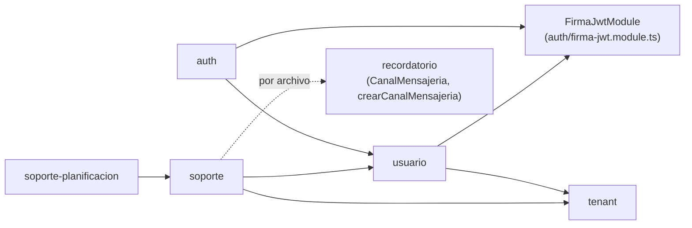

# Feature: US-10 — Perfil, suscripción y soporte del profesional (RF-04)

> **Fase:** [Fase 7 — US-10](../Fases/fase-7-us10-perfil.md) · **Feature:** este documento · **Plan:** [US-10](../US/10-perfil-cuenta.md) · **Relacionado:** [ADR-15](../Decisions/ADR-15.md), [ADR-01](../Decisions/ADR-01.md), [ADR-12](../Decisions/ADR-12.md), [ADR-13](../Decisions/ADR-13.md), [ADR-02](../Decisions/ADR-02.md), [ADR-03](../Decisions/ADR-03.md), [ADR-06](../Decisions/ADR-06.md), [DT-01](../Deudas/DT-01.md), [DT-02](../Deudas/DT-02.md), [DT-57](../Deudas/DT-57.md)…[DT-61](../Deudas/DT-61.md), [Q18](../PREGUNTAS-ABIERTAS.md#q18--nombre-legible-del-plan-free), [Q19](../PREGUNTAS-ABIERTAS.md#q19--casilla-de-soporte), [Cumplimiento](../Cumplimiento/README.md)

**Historia:** US-10 (RF-04) · decisiones de producto P1 a P8 del usuario (2026-10-31)
**Estado:** ✅ **en producción (2026-11-01)** · a `develop` por fast-forward el 2026-11-01, sin PR, y a `main` con el
[PR #15](https://github.com/Citia-solutions/citia-backend/pull/15) ese mismo día · **cierre pendiente** de las pruebas
manuales, de [Q18](../PREGUNTAS-ABIERTAS.md#q18--nombre-legible-del-plan-free) y de
[Q19](../PREGUNTAS-ABIERTAS.md#q19--casilla-de-soporte); lo que queda, en [Pendientes](#pendientes) · frontend: sin
registrar en este repo
**Pruebas:** 2385 unitarios (131 suites), 253 de integración (13 suites) y 379 e2e (18 suites) en verde contra
Postgres 16 local (2026-11-01), con `tsc`, ESLint y Prettier
**Commits:** `6e597be` (ADR-15 y plan), `a2058aa` (perfil, contraseña y corte), `35aec28` (suscripción), `fcfeac3`
(soporte), `c090105` (Definición de Terminado), `aeab86d` (resultados de integración y e2e) · a `develop` por
fast-forward, sin merge · release `cd659c1` (PR #15) · filas 118–124 de la [TRAZABILIDAD](../TRAZABILIDAD.md)
**ADRs:** **[15](../Decisions/ADR-15.md)** (aceptado el 2026-10-31; [notas de implementación](../Decisions/ADR-15.md#notas-de-implementación-2026-11-01)) ·
extiende [01](../Decisions/ADR-01.md) (la estrategia JWT consulta la base) · usa [12](../Decisions/ADR-12.md) §4–§6
(fila de trabajo + job) y [13](../Decisions/ADR-13.md) §7–§8 (`CanalMensajeria`) · respeta
[03](../Decisions/ADR-03.md) (el slug no se edita) · replica [06](../Decisions/ADR-06.md) y [02](../Decisions/ADR-02.md)

> El porqué de cada pieza está en ADR-15; el contrato completo (decisiones P y T, SQL, DTO, orden por agente y
> Definición de Terminado), en el plan US-10. Este documento resume **lo que existe en el código** y, en
> [Desviaciones del contrato](#desviaciones-del-contrato), dónde se apartó de él. Las reglas locales para los agentes
> viven en los `CLAUDE.md` de `usuario` y `soporte` (y una línea en el de `recordatorio`).

---

## Qué hace

> *Como profesional quiero ver y corregir mi nombre y mi especialidad, ver el enlace de agenda de mi organización y
> cambiar mi contraseña, sin pedírselo a nadie.*
> *Como administrador quiero ver en qué plan estoy y desde cuándo, aunque todavía no se cobre.*
> *Como profesional quiero escribirle a soporte desde la aplicación y que me respondan a mi correo.*

- **Perfil:** devuelve lo mismo que el login más la especialidad y la fecha de alta. Se editan **solo** el nombre y la
  especialidad; el correo, el rol, la organización y su slug se ven, no se tocan. Sin foto: el frontend dibuja las
  iniciales ([DT-57](../Deudas/DT-57.md)).
- **Suscripción, solo el administrador:** el plan con su nombre legible (*Plan piloto*, provisional hasta
  [Q18](../PREGUNTAS-ABIERTAS.md#q18--nombre-legible-del-plan-free)), *"Sin cobro durante el piloto"*, la fecha de alta,
  y renovación y método de pago en `null`. Un `PROFESIONAL` recibe 403. Sin tabla nueva.
- **Cambio de contraseña:** exige la actual; si está mal, **400 y la sesión sigue abierta** (nunca 401). Tras el cambio,
  la sesión que lo hizo recibe un token nuevo y **las demás dejan de valer** en su siguiente petición; la contraseña
  vieja ya no entra.
- **Soporte:** el mensaje (hasta 2000 caracteres, con una categoría opcional) se guarda al instante y un job lo envía por
  correo a la casilla de `SOPORTE_CORREO_DESTINO`, con *Responder a* = el correo del profesional. Tope de 5 por
  organización en 24 horas. **En production todavía no hay casilla**
  ([Q19](../PREGUNTAS-ABIERTAS.md#q19--casilla-de-soporte)): los mensajes se guardan y esperan en `pendiente`.

---

## Arquitectura (hexagonal)

### Lo que cambia por módulo

| Módulo | Qué se agrega |
|---|---|
| `usuario` | `PerfilController` (`usuarios/me`, `JwtAuthGuard` en la clase; el registro sigue público en `UsuariosController`) · `PerfilService` y `CambiarContrasenaService` (clases planas) · dominio: `especialidad` y `sesionesValidasDesde` en `Usuario`, `normalizarCambiosPerfil`, `sesiones.ts` (`inicioSesionesValidas`, `tokenEmitidoVigente`), `contrasena.ts` (política de la nueva), el puerto `EmisorSesion` y seis errores · `IUsuarioRepository`: `findById`, `actualizarPerfil`, `cambiarContrasena` (condicional al hash leído) y `estadoSesion` (una columna) · importa `FirmaJwtModule` |
| `auth` | `FirmaJwtModule` (el `JwtModule`, `ITokenSigner` y `EmisorSesion`, sacados de `AuthModule`, que lo importa y lo reexporta) · `JwtEmisorSesion` · `crearPayloadJwt` (único lugar donde se arman los claims, para el login y el emisor) · `VerificarSesionService` (`vigente()` y `verificar()`, con el motivo) · `JwtStrategy.validate` asíncrono |
| `tenant` | `SuscripcionController` (`organizacion`, `JwtAuthGuard` sin importar `AuthModule`) · `ConsultarSuscripcionService` (el 403 se decide aquí, con el rol del token) · catálogo de planes `domain/plan.ts` · `SoloAdministradorError` y `OrganizacionNoEncontradaError` |
| `soporte` (nuevo) | `SoporteController` · `RegistrarMensajeSoporteService` (tope y alta, no envía) · `EnviarMensajesSoporteService` (el envío) · plantilla pura `armarCorreoSoporte` · `MensajeSoporte` con sus transiciones · puerto y adaptador TypeORM de `mensajes_soporte` · su propia instancia de `CanalMensajeria` |
| `soporte-planificacion` (nuevo) | `PlanificadorSoporte` (job `soporte.envio`); solo lo importa `AppModule` |
| `shared` | cubos `cambioContrasena` y `soporte` en `LIMITES_TASA` · `SOPORTE_CORREO_DESTINO` en el entorno · `contrasenaActual`, `contrasenaNueva` y `mensaje` en `CAMPOS_SENSIBLES` |

### Reglas de dependencia

- **Sin ciclos:** `AuthModule → UsuariosModule → FirmaJwtModule` y `AuthModule → FirmaJwtModule`; `FirmaJwtModule` no
  importa nada del negocio. `usuario` firma el token nuevo por su puerto `EmisorSesion` sin depender de `AuthModule`
  ([ADR-15 §6](../Decisions/ADR-15.md#6-emitir-el-token-nuevo-sin-ciclo-entre-módulos-opción-d3)).
- **`soporte` no importa `RecordatorioModule`:** usa por archivo el puerto y la fábrica del canal de correo
  ([DT-59](../Deudas/DT-59.md)). `RecordatorioModule` sigue sin que nadie lo importe ([ADR-13 §1](../Decisions/ADR-13.md)).
- **Ningún hecho nuevo en `eventos_salida`:** la fila de `mensajes_soporte` **es** el outbox de ese correo; un job la
  envía después del commit ([ADR-12 §4](../Decisions/ADR-12.md), regla 4).
- `src/arquitectura.spec.ts` vigila también `soporte/domain` y `soporte/application`; `src/app.module.spec.ts` arma el
  contenedor completo sin base para cazar ciclos de módulos.

---

## Endpoints

Prefijo global `/api`; todas con `JwtAuthGuard`. Lo que identifica al usuario sale del token (`userId`, `tenantId`,
`rol`), nunca del cuerpo. Un 400 de **dominio** trae `message: string` en español; uno del `ValidationPipe`,
`message: string[]` en inglés: el frontend tiene que aceptar las dos formas
([ADR-15, nota 6](../Decisions/ADR-15.md#lo-que-toca-una-decisión-de-este-adr)).

| Método | Ruta | Límite de tasa | Respuesta | Errores |
|---|---|---|---|---|
| `GET` | `/api/usuarios/me` | — | 200 `PerfilDto` | 401 |
| `PATCH` | `/api/usuarios/me` | — | 200 `PerfilDto` | 400 · 401 |
| `PUT` | `/api/usuarios/me/contrasena` | `cambioContrasena` (5/h por IP) | 200 `{ accessToken }` | 400 · 401 · 409 · 429 |
| `GET` | `/api/organizacion/suscripcion` | — | 200 `SuscripcionDto` | 401 · 403 |
| `POST` | `/api/soporte/mensajes` | `soporte` (5/h por IP) | **201** `{ id, creadoEn }` | 400 · 401 · 429 |

### Perfil

`GET` y `PATCH /api/usuarios/me` → `PerfilDto`: `id`, `email`, `nombreCompleto`, `especialidad`, `rol`, `tenantId`,
`tenantSlug`, `tenantNombre` y `creadoEn`. Son los nombres de la respuesta del login más `especialidad` y `creadoEn`: el
frontend refresca su sesión guardada con el mismo mapeo. El enlace público lo arma el frontend con `tenantSlug`.

- **`PATCH`:** `nombreCompleto` (1 a 120, recortado; no se puede borrar: `null` o en blanco → 400) y `especialidad`
  (≤ 100; `''` o `null` la borran). `email`, `rol`, `tenantId` o un slug en el cuerpo se descartan en silencio
  (`whitelist`). Un `PATCH` sin campos devuelve el perfil sin escribir.
- **`especialidad` solo se muestra en el perfil**: nunca en el recordatorio ni al paciente (podría delatar su
  condición, [ADR-13 §12](../Decisions/ADR-13.md)).

### Cambio de contraseña

`PUT /api/usuarios/me/contrasena` con `{ contrasenaActual, contrasenaNueva }` → `200 { accessToken }`. En orden:

| Paso | Si falla |
|---|---|
| formato del DTO (nueva ≥ 8 unidades UTF-16) | **400** |
| el usuario existe en su organización | **401** (la sesión apunta a nadie) |
| la actual coincide con el hash | **400** *"La contraseña actual no es correcta"*, **nunca 401**: el frontend cierra la sesión con cualquier 401 |
| la nueva cumple la política: ≥ 8 caracteres reales y ≤ 72 bytes UTF-8 (bcrypt ignora lo que pasa de 72) | **400** |
| la nueva es distinta de la actual (comparada contra el hash) | **400** |
| `UPDATE` condicional al hash leído, con el corte de sesiones, en una transacción | **409** si otra petición la cambió entretanto |

El token nuevo se firma con `iat` = el corte (ver [Corte de sesiones](#corte-de-sesiones)). Sin correo de aviso (P5).
El log `usuarios.contrasena_cambiada` (solo ids) lo escribe el controller después del 200.

### Suscripción

`GET /api/organizacion/suscripcion` →
`{ plan, planNombre, descripcion, altaEn, renovacionEn: null, metodoPago: null }`. Lee `tenants.plan` y
`tenants.creado_en`; `free` → *Plan piloto* y *"Sin cobro durante el piloto"* (un código desconocido se muestra tal
cual, sin descripción). Un rol distinto de `ADMINISTRADOR` → **403** antes de leer nada: es la primera ruta que mira el
rol ([DT-02](../Deudas/DT-02.md)). Hoy todos los usuarios son administradores ([DT-07](../Deudas/DT-07.md)); el 403 se
prueba pasando un usuario a `PROFESIONAL` por SQL. Una organización que ya no existe → 401.

### Soporte

`POST /api/soporte/mensajes` con `{ categoria?: 'problema' | 'consulta' | 'sugerencia' | 'otro', mensaje }` →
**201** `{ id, creadoEn }`. Sin categoría, `otro`; el texto se recorta en los extremos (conserva los saltos internos) y
va de 1 a 2000 caracteres. Guarda la fila `pendiente` y **no envía nada**. Con 5 o más mensajes de la organización en
las últimas 24 horas → **429** *"Ya enviaste 5 mensajes a soporte en las últimas 24 horas. Vuelve a intentarlo más
tarde."* (tope blando: dos peticiones simultáneas pueden dejar 6). La respuesta no trae el texto ni el estado del envío.

---

## Corte de sesiones

Cierra la parte de revocación de [DT-01](../Deudas/DT-01.md) para dos casos: cambiar la contraseña y un usuario borrado
([ADR-15 §5](../Decisions/ADR-15.md#5-corte-de-sesiones-usuariossesiones_validas_desde-p5)).

- **La columna** `usuarios.sesiones_validas_desde` (`TIMESTAMPTZ NULL`). `NULL` = sin corte: es el valor de todos los
  usuarios al migrar, así que **nadie perdió su sesión con el release**. Solo la escribe el cambio de contraseña,
  **truncada al segundo** con el reloj de la app.
- **La regla** (`tokenEmitidoVigente`): sin corte, vale; con corte, vale si `iat × 1000 ≥ sesiones_validas_desde`. El
  token nuevo se firma con `iat` igual al corte, así que vale. Un token emitido en el **mismo segundo** del cambio,
  pero antes, sigue valiendo hasta vencer: ventana de menos de 1 s, aceptada.
- **Dónde:** `JwtStrategy.validate` llama a `VerificarSesionService.verificar()` en **cada** petición autenticada (una
  columna por clave primaria, **sin caché**). Token anterior al corte o usuario inexistente (también un id que no es un
  UUID) → **401** y el log `auth.sesion_cortada` con el motivo (`anterior_al_corte` | `usuario_inexistente`). Si la base
  falla, **500, no 401**: una caída no cierra sesiones en el frontend.
- **No cubre:** la renovación (`JWT_EXPIRES_IN` sigue en `1d`), el cierre de sesión real de un dispositivo ni un
  "cerrar todas mis sesiones" (pregunta 7 del plan, sin respuesta).

---

## Envío a soporte

El job `soporte.envio` (`PlanificadorSoporte`) corre **cada minuto, en el segundo 20** (`APP_TZ`), con lotes de 20.
**Solo se registra si hay `SOPORTE_CORREO_DESTINO`**; sin ella, el arranque deja el `warn` `soporte.sin_destino` y los
mensajes esperan en `pendiente` (salen con el primer tick después de cargarla). Nada con `PLANIFICADOR_ACTIVO=false`;
apagado ordenado; sin latido de Better Stack.

Por mensaje, **una transacción**: reclama la pendiente más antigua (`FOR UPDATE SKIP LOCKED`, barrido global de
[ADR-12 §6](../Decisions/ADR-12.md)), lee el usuario y la organización por sus puertos, arma el correo y lo envía por
`CanalMensajeria` con `Idempotency-Key = soporte/<id>`, la etiqueta `mensaje_soporte_id`, remitente
`CORREO_REMITENTE` y `Reply-To` = correo del profesional leído al enviar. Tope de 11 s por llamada y pausa de 500 ms
entre dos llamadas (la cuenta de Resend se comparte con los recordatorios).

| Resultado del canal | Efecto |
|---|---|
| `aceptado`, `posible_duplicado` | `enviado` (estado final: la entrega no se sigue; el webhook ignora estos eventos como `recordatorios.webhook_desconocido`) |
| `transitorio` | reintento a 1, 2, 4… hasta 60 min; `fallido` al octavo fallo |
| `cuota_agotada` | otra vez en 1 hora, sin gastar intento; corta el lote |
| `permanente` | `fallido` (alerta `soporte.envio_fallido`) |
| `configuracion` | no toca la fila; corta el lote y alerta |
| error propio (el canal lanza, pasa de 11 s, o una transición inválida) | se revierte y, en otra transacción, cuenta como un fallo (`soporte.envio_error_interno`) |

La plantilla escapa todo el HTML, deja el asunto en una línea (`Soporte · <Categoría> · <organización>`) y es
determinista (usa `creado_en`): un reintento manda el mismo correo. Un `fallido` se reenvía volviéndolo a `pendiente`
con SQL; no hay ruta para eso.

---

## Esquema de BD

Dos migraciones aditivas, una por tabla ([plan § Modelo de datos](../US/10-perfil-cuenta.md#modelo-de-datos)). **Los dos
`down` son destructivos.** Estados y categorías van como `VARCHAR` + `CHECK`, no como tipo enum.

| Migración | Qué hace | `down` |
|---|---|---|
| `1750000019000-AddPerfilYSesionesAUsuarios` | `usuarios.especialidad` (`VARCHAR(100) NULL`, CHECK `CHK_usuarios_especialidad_no_vacia`) y `usuarios.sesiones_validas_desde` (`TIMESTAMPTZ NULL`); sin relleno | pierde las especialidades y devuelve la validez a los tokens anteriores a un cambio (como mucho, 1 día) |
| `1750000020000-CreateMensajesSoporte` | tabla `mensajes_soporte` (texto, categoría, estado de envío, intentos, próximo intento, último error como código, proveedor y su id, fechas), FK `RESTRICT` a `tenants` y `usuarios`, CHECK de categoría, largo, estado y coherencia de `enviado_en`, índice parcial de pendientes e índice `(tenant_id, creado_en)` para el tope | borra todos los mensajes |

- El CHECK `btrim(...) <> ''` solo quita espacios: la defensa contra un texto de solo saltos de línea es el dominio, que
  recorta antes de guardar.
- [DT-46](../Deudas/DT-46.md) sigue abierta: las columnas nuevas declaran `timestamptz`, pero `usuarios.creado_en` y
  `tenants.creado_en` no, y ahora se muestran (`creadoEn` del perfil, `altaEn` de la suscripción).
- `seed.ts` borra los `mensajes_soporte` del tenant demo antes de sus usuarios.

---

## Seguridad y privacidad

| Qué | Cómo |
|---|---|
| Contraseñas y tokens fuera de los logs | `contrasenaActual` y `contrasenaNueva` se redactan; los logs de la fase llevan solo ids, estados, motivos y códigos |
| El texto de soporte fuera de los logs | la clave `mensaje` se redacta **entera en cualquier log** (para registrar un mensaje saliente hay que usar otra clave; los de soporte usan `mensajeId`); `ultimo_error` guarda solo un código |
| El texto de soporte, un flujo nuevo | va a la base (Railway), a Resend y a la casilla de soporte: si el profesional escribe datos de un paciente, salen del encargo. El frontend avisa; el backend no filtra. Sin plazo de conservación ([DT-26](../Deudas/DT-26.md)); la casilla es un proveedor nuevo ([DT-52](../Deudas/DT-52.md)); ver [Cumplimiento](../Cumplimiento/README.md) |
| `Reply-To` | el correo del profesional, que no está verificado ([DT-03](../Deudas/DT-03.md)) |
| El 400 de la contraseña actual | nunca 401, para no sacar al usuario por un error de tipeo |
| El rol | sale del token: un cambio de rol se vería con el próximo token ([DT-02](../Deudas/DT-02.md)) |

### Límite de tasa

| Cubo | Límite | Clave | Ruta |
|---|---|---|---|
| `cambioContrasena` | 5 por hora | IP | `PUT /api/usuarios/me/contrasena` |
| `soporte` | 5 por hora | IP | `POST /api/soporte/mensajes` |

Por IP y no por usuario porque el guard global corre antes que `JwtAuthGuard`; con el límite activo, el 429 llega antes
que el 401. Las personas de una clínica detrás de una misma IP comparten el cupo ([DT-04](../Deudas/DT-04.md)). El tope
de soporte por organización no es un cubo: vive en el caso de uso y cuenta filas.

---

## Configuración

| Variable | Default | Para qué |
|---|---|---|
| `SOPORTE_CORREO_DESTINO` | **ninguno**, en todos los entornos | la casilla que recibe los mensajes. **Opcional también en producción**: sin ella la app arranca y el job no se registra. Si viene, una sola dirección simple (sin nombre visible, `<>` ni listas con `,` o `;`); mal escrita, **detiene el arranque**. Valor pendiente de [Q19](../PREGUNTAS-ABIERTAS.md#q19--casilla-de-soporte); **no está cargada en production** (2026-11-01) |

- Opcional a propósito: una variable obligatoria nueva tumbó production ~9 minutos en el release de la Fase 3
  ([incidente](../Fases/fase-3-us04-respuesta-paciente.md#incidente-production-caído-9-minutos)).
- Se reutilizan `MENSAJERIA_ADAPTADOR`, `RESEND_API_KEY`, `CORREO_REMITENTE`, `APP_TZ` y `JWT_SECRET`. Con
  `MENSAJERIA_ADAPTADOR=registro` (staging), un mensaje queda `enviado` sin haber salido ([DT-40](../Deudas/DT-40.md)).
- `.env.example` documenta la variable, comentada. Sin dependencias nuevas.

---

## Tests y verificación

| Archivo | Tipo | Cubre |
|---|---|---|
| `usuario/domain/`: `sesiones.spec.ts`, `contrasena.spec.ts`, `usuario.entity.spec.ts` | unit | truncar al segundo, la regla del corte (con el borde del mismo segundo), 8 caracteres y 72 bytes (multibyte), normalización del perfil |
| `usuario/application/perfil.service.spec.ts`, `cambiar-contrasena.service.spec.ts` | unit | perfil con la organización, `PATCH` vacío sin escribir; el orden de las comprobaciones, el `UPDATE` condicional, el token firmado con el corte |
| `usuario/presentation/perfil.controller.spec.ts`, `dto/*.spec.ts`, `usuarios.module.spec.ts` | unit | cada error a su código (400 para la actual, nunca 401; 409; 401), validaciones del DTO, cableado sin base |
| `auth/`: `application/verificar-sesion.service.spec.ts`, `application/auth.service.spec.ts`, `jwt.strategy.spec.ts`, `infrastructure/jwt-emisor-sesion.spec.ts`, `firma-jwt.module.spec.ts`, `jwt-payload.interface.spec.ts` | unit | vigencia, 401 con el log del motivo, 500 si falla la base, `iat` del token nuevo, el login sin cambios |
| `tenant/domain/plan.spec.ts`, `application/consultar-suscripcion.service.spec.ts`, `presentation/suscripcion.controller.spec.ts` | unit | catálogo, 403 sin leer el repositorio, 200 |
| `soporte/domain/mensaje-soporte.entity.spec.ts`, `application/*.spec.ts`, `presentation/*.spec.ts`, `infrastructure/**/*.spec.ts` | unit | transiciones, tope, los seis resultados del canal y el error propio, plantilla escapada y determinista, 201 y 429, el job (sin destino no registra) |
| `shared/.../entorno.spec.ts`, `opciones-limite-tasa.spec.ts`, `opciones-logger.spec.ts`, `limitar-tasa.decorator.spec.ts`, `arquitectura.spec.ts`, `app.module.spec.ts` | unit | `SOPORTE_CORREO_DESTINO` opcional y validada, los dos cubos, la redacción, las capas de `soporte`, el grafo de módulos |
| `database/integration/migraciones-us10.integration.spec.ts` | integración | las dos migraciones en un lote, esquema, usuarios existentes en `NULL`, `down` y subir otra vez |
| `usuario/integration/sesiones-usuario.integration.spec.ts` | integración | `estadoSesion`; **dos cambios de contraseña a la vez → uno escribe**; `actualizarPerfil`; CHECK |
| `soporte/integration/envio-soporte.integration.spec.ts` | integración | **`SKIP LOCKED` con dos transacciones y dos `ejecutar` en paralelo → cada mensaje una vez**; tope por organización; CHECK |
| `test/perfil-usuario.e2e-spec.ts`, `test/cambio-contrasena.e2e-spec.ts`, `test/soporte.e2e-spec.ts` | e2e con Postgres | perfil y suscripción (también el 403); el corte con dos sesiones, la contraseña vieja y un usuario borrado; soporte con el job a mano y los logs sin el texto |
| `test/limite-tasa.e2e-spec.ts`, `test/planificador.e2e-spec.ts` y los cuatro e2e con `JwtStrategy` directa (con `test/support/sesion-vigente-falsa.ts`) | e2e | los dos cubos nuevos; `soporte.envio` no se registra con el planificador apagado; nada roto en lo anterior |

**Resultado (2026-11-01):** **2385** unitarios (131 suites), **253** de integración (13 suites) y **379** e2e (18
suites) en verde contra Postgres 16 local, más `tsc`, ESLint y Prettier. Los e2e, con la autorización del usuario.
Estado punto por punto en la [Definición de Terminado](../US/10-perfil-cuenta.md#definición-de-terminado).

**Pendiente manual:** la [verificación manual mínima](../US/10-perfil-cuenta.md#verificación-manual-mínima), en staging
(pasos 1 a 6) y en production (7 a 9). Ninguna hecha al 2026-11-01.

---

## Desviaciones del contrato

El contrato es el plan [US-10](../US/10-perfil-cuenta.md). **Ninguna desviación rediseña.** Las que tocan una decisión
de ADR-15 están, con su porqué, en sus
[notas de implementación](../Decisions/ADR-15.md#lo-que-toca-una-decisión-de-este-adr); el resto, por paso, en el
[plan § Desvíos](../US/10-perfil-cuenta.md#desvíos-de-la-implementación-2026-11-01). Las que más pesan:

| Contrato | Implementado |
|---|---|
| `VerificarSesionService.vigente()` | además `verificar()`, con el motivo para el log `auth.sesion_cortada` |
| usuario inexistente → 401 | también un `sub` o `tenantId` que no es un UUID (guardas en los repositorios: nunca un `22P02` que daría 500) |
| si la base no responde, falla | **500, no 401**: un 401 cerraría la sesión en el frontend |
| nueva ≥ 8 "como el registro" | el dominio cuenta caracteres reales y el DTO unidades UTF-16; el registro no tiene el tope de 72 bytes ([DT-61](../Deudas/DT-61.md)) |
| la forma del 400 | de dominio, `string` en español; del `ValidationPipe`, `string[]` en inglés |
| el envío "como los recordatorios" | tope propio de 11 s y pausa de 500 ms; un canal que lanza es **error propio** (en los recordatorios, `transitorio`): divergencia anotada en [DT-59](../Deudas/DT-59.md) |
| sin destino, el job no se registra | además, invocado a mano sin destino no reclama nada (`configuracion = 'sin_destino'`) |
| `mensaje` en `CAMPOS_SENSIBLES` | la clave se redacta entera en cualquier log |
| un `recortar` en `presentation` | tres copias del decorador `Recortar` ([DT-60](../Deudas/DT-60.md)) |
| `SuscripcionDto` | igual; error nuevo `OrganizacionNoEncontradaError` → 401 |

---

## En producción (2026-11-01)

Llegó a `develop` por **fast-forward** el 2026-11-01 a las 12:36 (hora de Chile), sin PR, y a `main` con el
[PR #15](https://github.com/Citia-solutions/citia-backend/pull/15) (`cd659c1`) a las 14:09; production corre al arrancar
las migraciones `1750000019000` y `1750000020000`. **Sin verificar:** nadie revisó todavía los Deploy Logs de staging ni
de production. Sin `SOPORTE_CORREO_DESTINO` en production. Cómo salió y lo que falta, en la
[guía de la fase](../Fases/fase-7-us10-perfil.md#release-a-producción-2026-11-01).

---

## Pendientes

| Qué | Nota |
|---|---|
| ~~**Release**~~ | ✅ 2026-11-01 (PR #15, `cd659c1`). A `develop` llegó por fast-forward, sin PR ([TRAZABILIDAD](../TRAZABILIDAD.md), filas 118–124) |
| Revisar los **Deploy Logs** de staging y production | arranque sin error, migraciones `1750000019000` y `1750000020000` aplicadas, `soporte.sin_destino` (lección de la [Fase 3](../Fases/fase-3-us04-respuesta-paciente.md#lecciones-aprendidas): una variable y un arranque se confirman en los Deploy Logs) |
| La **verificación manual mínima** | [plan](../US/10-perfil-cuenta.md#verificación-manual-mínima): perfil, corte con dos navegadores, contraseña actual mal escrita, soporte, suscripción y, en production, un mensaje que llegue a la casilla |
| [Q19](../PREGUNTAS-ABIERTAS.md#q19--casilla-de-soporte) y `SOPORTE_CORREO_DESTINO` | sin la variable, los mensajes esperan en `pendiente`; al cargarla, salen con el primer tick. La casilla entra a [DT-52](../Deudas/DT-52.md) **antes** de usarse |
| [Q18](../PREGUNTAS-ABIERTAS.md#q18--nombre-legible-del-plan-free) y las otras seis preguntas del plan | el código usa los provisionales (*Plan piloto*, categoría cerrada, tope de 5 en 24 h, especialidad solo en el perfil, sin "cerrar todas mis sesiones") |
| Frontend | sin registrar en este repo |
| Severidad de [DT-01](../Deudas/DT-01.md) | se revisa al cerrar la fase |

---

## Deudas técnicas asociadas

**Cierra en parte:** [DT-01](../Deudas/DT-01.md) — el corte de las demás sesiones al cambiar la contraseña y la salida
de un usuario borrado (en producción desde el 2026-11-01); la renovación y el cierre de sesión real siguen abiertos.

**Contrajo:** [DT-59](../Deudas/DT-59.md) (el canal de correo de `recordatorio` usado por `soporte`, abierta desde la
implementación).

**Aplazadas por decisión del usuario:** [DT-57](../Deudas/DT-57.md) (sin foto) · [DT-58](../Deudas/DT-58.md) (el nombre
de la organización no se corrige).

**Detectó:** [DT-60](../Deudas/DT-60.md) (`Recortar` en tres copias) · [DT-61](../Deudas/DT-61.md) (el registro no
aplica la política de contraseña del cambio).

**Toca:** [DT-02](../Deudas/DT-02.md) (primera comprobación de rol, sin guard general) · [DT-03](../Deudas/DT-03.md) (la
recuperación de contraseña y el cambio de correo siguen fuera; `Reply-To` sin verificar) · [DT-04](../Deudas/DT-04.md)
(límite solo por IP) · [DT-46](../Deudas/DT-46.md) (fechas sin `timestamptz` que ahora se muestran) ·
[DT-19](../Deudas/DT-19.md) (un `fallido` de soporte solo se ve en los logs) · [DT-26](../Deudas/DT-26.md),
[DT-52](../Deudas/DT-52.md), [DT-53](../Deudas/DT-53.md), [DT-56](../Deudas/DT-56.md) (el flujo de los mensajes a
soporte) · [DT-36](../Deudas/DT-36.md) (otro tipo de correo por la misma cuenta de Resend, fuera del contador local) ·
[DT-40](../Deudas/DT-40.md) (con `registro`, `enviado` sin salir).

Índice completo: [`../Deudas/README.md`](../Deudas/README.md).
