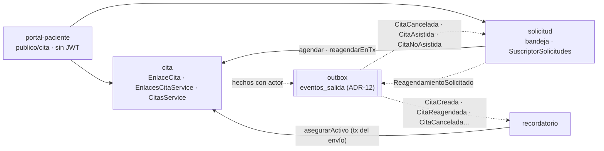

# Plan US-04 — Respuesta del paciente desde el recordatorio (RF-07, + US-02.07)

> **Fase:** [Fase 3 — US-04](../Fases/fase-3-us04-respuesta-paciente.md) · **Feature:** [us04-respuesta-paciente](../Features/us04-respuesta-paciente.md) · **Plan:** este documento · **Relacionado:** [ADR-10](../Decisions/ADR-10.md), [ADR-13](../Decisions/ADR-13.md), [ADR-12](../Decisions/ADR-12.md), [ADR-09](../Decisions/ADR-09.md), [ADR-04](../Decisions/ADR-04.md), [US-02.07](02.07-paciente-reagenda-cancela.md), [FD-06](../Frontend-Decisions/FD-06.md), [DT-11](../Deudas/DT-11.md), [DT-16](../Deudas/DT-16.md), [DT-18](../Deudas/DT-18.md), [DT-42](../Deudas/DT-42.md), [DT-43](../Deudas/DT-43.md), [DT-44](../Deudas/DT-44.md), [DT-45](../Deudas/DT-45.md), [Q11](../PREGUNTAS-ABIERTAS.md#q11--cómo-le-llega-al-paciente-el-enlace-de-su-cita)

> **Estado (2026-10-15):** ✅ **implementada y verificada en local · pendiente de release.** Backend y
> frontend construidos en la rama `feature/fase3-respuesta-paciente` de cada repo, contra el contrato de este
> plan; sin commits todavía. Lo que existe y dónde se apartó del contrato:
> [us04-respuesta-paciente](../Features/us04-respuesta-paciente.md). [Definición de
> Terminado](#definición-de-terminado): lo automático ✅; los dos puntos manuales ⬜.
> *(2026-10-14: en construcción; diseño aprobado por el arquitecto, [ADR-10](../Decisions/ADR-10.md)
> aceptado, Q11 = B.)*
> **Absorbe** la subtarea [US-02.07](02.07-paciente-reagenda-cancela.md) (el paciente cancela o pide otra
> hora), cuyo análisis se conserva.

> Solo decisiones y orden. Sin código. Brief para los agentes. El porqué de cada pieza está en
> [ADR-10](../Decisions/ADR-10.md); aquí va el qué, en qué orden y cuándo está terminado. **Este plan es el
> contrato:** si algo choca con el código, se implementa lo más cercano posible y se reporta; no se
> rediseña.

---

## Descripción

- Como **paciente** quiero confirmar, cancelar o pedir otra hora desde el correo del recordatorio, sin
  cuenta y sin llamar, para avisar a tiempo.
- Como **profesional de la salud** quiero saber quién confirmó o canceló cada cita, atender las peticiones
  de otra hora en mi bandeja y poder invalidar el enlace si llegó a quien no era.

**Criterios de aceptación**

- Cada recordatorio trae **un botón**, *Ver o responder mi hora*, que abre `/cita#<token>`. Todos los
  recordatorios de una cita llevan el mismo enlace.
- La página muestra fecha y hora (en la zona de Chile), duración, profesional, organización y estado.
  **Nunca** el nombre del paciente, su RUT, su contacto, el tipo de consulta ni ids internos.
- **Abrir la página no cambia nada.** Confirmar, cancelar y pedir otra hora son botones.
- Confirmar solo si la cita está `pendiente` y no hay una petición de otra hora abierta. Cancelar, con
  motivo opcional. Pedir otra hora, con una preferencia obligatoria y un motivo opcional; **la cita no se
  mueve**.
- Después del inicio de la cita, con la cita ya cerrada o con el enlace invalidado, la página dice
  *"Enlace no válido o vencido"*.
- En el voucher, el profesional ve *"Confirmada por el paciente"* / *"Confirmada por ti"*, *"Cancelada por el
  paciente"*, la nota *"El paciente pidió otra hora"* y el botón *"Invalidar enlace del paciente"*.
- En la bandeja, una petición de otra hora aparece como *"Pide otra hora"* con la hora original. Aceptarla
  pide solo fecha y hora y **mueve la misma cita**; rechazarla no la toca.
- El enlace, el login, el registro y la solicitud pública tienen límite de tasa.

---

## Punto de partida (lo que ya existe)

Verificado en el código (2026-10-14):

- **Recordatorios en producción** desde el 2026-10-06 ([ADR-13](../Decisions/ADR-13.md)). La plantilla
  (`recordatorio/application/plantilla-recordatorio.ts`) recibe un bloque `accion?: { texto, url }` que hoy
  va vacío. El envío corre dentro de una transacción y usa `Idempotency-Key` = id del recordatorio.
- **Transiciones listas:** `Cita.confirmar()`, `cancelar()` y `reagendar()` ([ADR-04](../Decisions/ADR-04.md),
  [ADR-09 §5](../Decisions/ADR-09.md)).
- **Esqueleto de mutación** (`CitasService.mutar`, `registrarCambio`, `publicar`): recibe un
  `AuthenticatedUser`, fija el actor `profesional` y toma el `usuarioId` del hecho del token. La carga de la
  cita no bloquea la fila.
- **`enum_cambios_cita_actor`** ya tiene `profesional`, `paciente` y `sistema`: no hace falta `ADD VALUE`.
- **`solicitudes_cita`**: `rut`, `correo`, `telefono` y `motivo` son NOT NULL; estados `recibida · aceptada ·
  rechazada` (`enum_solicitudes_cita_estado`); regla anti-spam por RUT con ventana de 72 h
  (`buscarAbiertaPorRut`); aceptar exige `inicio`, `duracionMin` y `tipoConsulta`.
- **Outbox** ([ADR-12](../Decisions/ADR-12.md)) con `SuscriptorEventos` (`eventos`, `manejar`); un solo
  suscriptor, el de recordatorios.
- **Infraestructura:** `pino` redacta `authorization`; CORS sale de `shared/infrastructure/config/origenes-cors.ts`;
  `entorno.ts` valida `JWT_SECRET` al arrancar; `FRONTEND_URL` existe. **No** hay `trust proxy` ni
  `@nestjs/throttler`.

---

## Decisiones

Aprobadas por el arquitecto el 2026-10-14. El porqué de cada una está en [ADR-10](../Decisions/ADR-10.md).

| Id | Decisión | ADR-10 |
|---|---|---|
| S0 | Q11 = B: el sistema pone el enlace dentro del recordatorio (correo por Resend). | §6 |
| S1 | El profesional puede **invalidar** el enlace desde el voucher (sube la versión; el anterior deja de servir). | §1 regla 5 |
| S2 | La página muestra lo mínimo: inicio, zona, duración, estado, nombre del profesional, nombre de la organización, acciones permitidas y la petición de otra hora abierta. **Nunca**: nombre del paciente, RUT, contacto, `tipoConsulta`, ids internos. | §2 |
| S3 | Token en el **fragmento** (`/cita#<token>`), enviado a la API en la cabecera `X-Enlace-Cita`. Respuestas públicas con `Cache-Control: no-store` y `Referrer-Policy: no-referrer`. La página no carga scripts de terceros y limpia el fragmento (`history.replaceState`). **Abrir la página nunca ejecuta una acción**: toda acción es un `POST` tras un clic. | §1 regla 7 |
| E1 | **Un enlace activo por cita**, el mismo en todos sus recordatorios. | §1 regla 3 |
| E2 | Token **recalculable con HMAC**: `base64url(HMAC-SHA256(ENLACE_CITA_CLAVE, "enlace-cita:" + citaId + ":" + version))`, 43 caracteres. En la base solo `token_hash = sha256(token)` en hex. | §1 regla 2 |
| E3 | El enlace nace **perezosamente al enviar el primer recordatorio** (`asegurarActivo`, idempotente). | §1 regla 3 |
| E4 | En el voucher, solo *"Invalidar enlace"* (no *"copiar enlace"*). | §1 regla 3 |
| E5 | El correo lleva **un solo botón fijo**: texto `Ver o responder mi hora`, url `${FRONTEND_URL}/cita#${token}`. Nunca depende del estado (la plantilla sigue siendo determinista entre reintentos). | §6 |
| R1 | Pedir otra hora **no toca la cita original** (sigue en el dashboard y ocupa su hora). | §4 |
| R2 | Pedir otra hora crea una **`SolicitudCita` de tipo `reagendamiento`** en la bandeja existente. Aceptarla **mueve la cita original** con `reagendar` (mismo id, vuelve a `pendiente`, los recordatorios se reprograman solos); `solicitud.citaId = citaOrigenId`. | §4 |
| R3 | Rechazarla no avisa al paciente (v1). La cita original queda como estaba. | §4 |
| R4 | Nada en el dashboard. El voucher muestra *"El paciente pidió otra hora"* (`GET /api/solicitudes?citaOrigenId=<id>&estado=recibida`). | §4 |
| R5 | **Una petición de reagendamiento `recibida` por cita** (índice único parcial). La regla anti-spam por RUT (72 h) **solo cuenta las `nueva`**. | §4 |
| R6 | Con una petición de otra hora abierta, el enlace **solo permite cancelar**. | §4 |
| G1 | Regla de `ghosting` (se **documenta**, no se implementa): `pendiente` pasado el fin del día de la clínica de su `inicio` **y** al menos un recordatorio con enlace `enviado`/`entregado` **y** sin petición de otra hora `recibida`. Si no, queda sin cerrar (neutra para el scoring). Fecha de corte: el despliegue de la Fase 3 ([DT-11](../Deudas/DT-11.md)). | §5 |
| G2 | La confirmación del profesional y la del paciente pesan igual (el peso se decide en la Fase 5; hoy solo se guarda el actor). | §3 |
| G3 | El voucher muestra quién confirmó y quién canceló: `confirmadaPor` y `canceladaPor` en `GET /api/citas/:id`, derivados de la bitácora. | §3 |
| G4 | El job de `ghosting` **no** se construye en esta fase. | §5 |
| L1 | Límite de tasa en: rutas del enlace, login, registro y solicitud pública. | §10 |
| L2 | En memoria (`@nestjs/throttler`), una réplica en Railway. | §10 |
| L3 | Límites por superficie ([abajo](#límite-de-tasa)). Sin bloqueo por fallos: el throttler cuenta peticiones. | §10 |
| — | El consentimiento ([DT-16](../Deudas/DT-16.md)) sigue como deuda: no se consulta antes de enviar. | §6 |

---

## Modelo de datos

Migraciones TypeORM nuevas, versionadas ([ADR-00](../Decisions/ADR-00.md)).

### Tabla nueva `enlaces_cita` (módulo `cita`)

| Columna | Tipo | Notas |
|---|---|---|
| `id` | uuid PK | es el `actor_id` del paciente en `cambios_cita` |
| `cita_id` | uuid NOT NULL | FK a `citas(id)` (mismo módulo) |
| `tenant_id` | uuid NOT NULL | |
| `version` | int NOT NULL | empieza en 1 |
| `token_hash` | char(64) NOT NULL **UNIQUE** | sha256 hex del token |
| `emitido_en` | timestamptz NOT NULL default `now()` | |
| `revocado_en` | timestamptz NULL | |
| `motivo_revocacion` | varchar NULL | hoy solo `invalidado` |
| `revocado_por` | uuid NULL | usuario que invalidó |

- UNIQUE (`cita_id`, `version`).
- UNIQUE parcial (`cita_id`) WHERE `revocado_en IS NULL` → como máximo un enlace activo por cita.
- `asegurarActivo`: si hay uno activo, se usa; si no, se inserta `max(version) + 1` (1 si no hay ninguno) con
  `INSERT … ON CONFLICT DO NOTHING` y se relee. Determinista: la misma (cita, versión) da el mismo token.

### `solicitudes_cita` (módulo `solicitud`) — cambios

- `tipo`: enum nuevo (`nueva | reagendamiento`), NOT NULL, por defecto `nueva`.
- `cita_origen_id` uuid NULL (sin FK, como `cita_id` — ADR-09).
- `enlace_id` uuid NULL (con qué enlace se pidió; sin FK).
- `rut` pasa a NULL (el alta manual permite pacientes sin RUT); `correo` pasa a NULL.
- `ALTER TYPE enum_solicitudes_cita_estado ADD VALUE 'descartada'`.
- CHECK: `tipo = 'reagendamiento'` ⇒ `cita_origen_id IS NOT NULL`.
- UNIQUE parcial (`cita_origen_id`) WHERE `tipo = 'reagendamiento' AND estado = 'recibida'`.
- Índice (`tenant_id`, `cita_origen_id`) para `GET /api/solicitudes?citaOrigenId=`.

### `cambios_cita` — sin cambio de esquema

Para el paciente: `actor_tipo = 'paciente'`, `actor_id = enlaces_cita.id`. El enum ya contiene `paciente` y
`sistema`.

---

## Módulos y dependencias



**Reglas:** `cita` **no** importa `solicitud`, `recordatorio` ni `portal-paciente`. Sin ciclos. `solicitud` se
entera de que la cita terminó por el **outbox** (suscriptor), no por una llamada desde `cita`.
`portal-paciente` es composición: no tiene dominio propio. Para los nombres del profesional y de la
organización usa los módulos `usuario` / `tenant` o un lector propio, a criterio de `api-agent`.

| Módulo | Qué suma en esta fase |
|---|---|
| `cita` | dominio `EnlaceCita` (crear v1 / siguiente versión, `estaActivo()`, `invalidar(usuarioId, ahora)`); puerto `EnlaceCitaRepository` (todo con `tx`); puerto `DerivadorTokenEnlace` (`derivar(citaId, version)`, `hashear(token)`) con adaptador sobre `node:crypto`; **`EnlacesCitaService`** exportado: `asegurarActivo(citaId, tenantId, tx)` → token, `resolver(token, tx)` → `{ enlace, cita } \| null` (formato inválido → `null` sin tocar la base; cita con `FOR UPDATE`), `invalidar(citaId, usuario)`. Validez de dominio: no revocado ∧ vigente ∧ `ahora < inicio`. Refactor del actor (`Actor` + `tenantId` explícito; `usuarioId` del hecho = `cita.usuarioId`; hechos con `actor: { tipo, id }`; carga con `FOR UPDATE`). Métodos `confirmarComoPaciente(cita, enlace, tx)`, `cancelarComoPaciente(cita, enlace, motivo, tx)`, `reagendarEnTx(citaId, nuevoInicio, usuario, tx)`. `confirmadaPor` y `canceladaPor` en el detalle |
| `recordatorio` | importa `CitaModule`. En `enviar()`: `asegurarActivo` dentro de la transacción del envío y `accion = { texto: 'Ver o responder mi hora', url: \`${FRONTEND_URL}/cita#${token}\` }` a la plantilla. Si falla, el envío falla como error interno (reintento). Matiza [ADR-13 §1](../Decisions/ADR-13.md) |
| `solicitud` | `tipo`, `citaOrigenId`, `enlaceId`, estado terminal `DESCARTADA`; fábrica `pedirOtraHora(...)` (datos del paciente copiados de su ficha; `usuarioId` = dueño de la cita); `descartar(ahora)`. Repositorio: `buscarAbiertaPorRut` solo cuenta `tipo = 'nueva'`; nuevo `buscarReagendamientoAbierto(citaOrigenId, tx)`; listar con filtro `citaOrigenId`. Aceptar con rama de reagendamiento. `SuscriptorSolicitudes`. Hecho `ReagendamientoSolicitado` (`citaId`, `usuarioId` de la cita, `solicitudId`, `actor: { tipo: 'paciente', id: enlaceId }`) |
| `portal-paciente` (nuevo) | `src/modules/portal-paciente/`: controller `@Controller('publico/cita')`, sin JWT, con las cuatro rutas de abajo. Cada acción: **una** transacción; `resolver` con `FOR UPDATE`; re-evalúa la validez y `accionesPermitidas` dentro de ella. Al cancelar, el descarte de la petición abierta ocurre por el suscriptor, o directamente en la misma transacción (a criterio de `api-agent`; el portal sí puede llamar a los dos módulos) |

---

## Rutas

Prefijo global `/api`.

### Públicas (`portal-paciente`, sin JWT)

| Método | Ruta | Cuerpo | Éxito |
|---|---|---|---|
| GET | `/api/publico/cita` | — | 200 `VistaCitaPacienteDto` |
| POST | `/api/publico/cita/confirmar` | — | 200 `VistaCitaPacienteDto` |
| POST | `/api/publico/cita/cancelar` | `{ motivo?: string ≤ 300 }` | 200 `VistaCitaPacienteDto` |
| POST | `/api/publico/cita/otra-hora` | `{ preferencia: string 1..300, motivo?: string ≤ 300 }` | 201 `VistaCitaPacienteDto` |

- Cabecera obligatoria **`X-Enlace-Cita`**.
- **Todo token no válido** (ausente, formato, inexistente, revocado, cita terminal, `inicio` ya pasado) →
  **404 idéntico**: `{ "statusCode": 404, "message": "Enlace no válido o vencido" }`.
- Acción no permitida con un enlace válido (p. ej. confirmar una cita ya confirmada, o confirmar con una
  petición abierta) → **409** `{ "statusCode": 409, "message": "Esta acción ya no está disponible" }`.
- Respuestas con `Cache-Control: no-store` y `Referrer-Policy: no-referrer`.

```ts
VistaCitaPacienteDto = {
  inicio: string;            // ISO UTC
  zonaHoraria: string;       // APP_TZ, p. ej. 'America/Santiago'
  duracionMin: number;
  estado: 'pendiente' | 'confirmada' | 'cancelada' | 'asistio' | 'no_asistio' | 'ghosting';
  profesional: string;       // Usuario.nombreCompleto del dueño
  organizacion: string;      // Tenant.nombre
  accionesPermitidas: Array<'confirmar' | 'cancelar' | 'pedirOtraHora'>;
  solicitudOtraHora: { preferencia: string; solicitadaEn: string } | null;
}
```

`accionesPermitidas` (calculadas en el backend, siempre con `ahora < inicio`): `confirmar` si la cita está
`pendiente` y sin petición abierta · `cancelar` si está vigente · `pedirOtraHora` si está vigente y sin
petición abierta. Tras cancelar, el 200 devuelve la vista con estado `cancelada` y sin acciones; un `GET`
posterior ya responde 404 porque la cita es terminal.

### Autenticadas (JWT; cambios aditivos)

| Método | Ruta | Cambio |
|---|---|---|
| POST | `/api/citas/:id/enlace/invalidar` | **nueva** · 204; 404 si la cita no es del tenant; 204 también si no hay enlace activo |
| GET | `/api/citas/:id` | suma `confirmadaPor` y `canceladaPor`: `'paciente' \| 'profesional' \| 'sistema' \| null` |
| GET | `/api/solicitudes` | acepta `citaOrigenId` (uuid) además de `estado`; `SolicitudBandejaDto` suma `tipo`, `citaOrigenId` y `citaOrigen: { inicio, duracionMin, estado } \| null` |
| POST | `/api/solicitudes/:id/aceptar` | si `tipo = reagendamiento`: mueve la cita origen con `reagendarEnTx(citaOrigenId, dto.inicio, usuario, tx)` y `solicitud.aceptar(usuarioId, citaOrigenId)`; `duracionMin` y `tipoConsulta` pasan a opcionales y se ignoran (para `nueva` siguen obligatorios: el servicio responde 400); cita origen terminal → 409 |

`GET /api/citas/hoy` y `CitaDashboardDto` **no cambian** (R4).

### El correo

Un solo botón fijo en cada recordatorio: `Ver o responder mi hora` → `${FRONTEND_URL}/cita#${token}`. No
depende del estado de la cita. Mismo recordatorio + misma versión del enlace ⇒ mismo contenido.

### Límite de tasa

| Superficie | Clave | Límite |
|---|---|---|
| `/api/publico/cita*` (todas) | IP | 30 / minuto |
| `POST` de `/api/publico/cita/*` | enlace (sha256 de la cabecera) | 5 / hora |
| `POST /api/auth/login` | IP | 5 / minuto |
| `POST /api/usuarios` (registro) | IP | 5 / hora |
| `POST /api/publico/:tenantSlug/solicitudes` | IP | 5 / hora |

Exceso → **429** genérico. Desactivable en tests **por configuración** (no parcheando cada test), con al
menos un e2e que demuestre el 429.

---

## Prerrequisitos operativos (usuario)

- **Railway:** cargar `ENLACE_CITA_CLAVE` en staging y en production, **distinta en cada entorno** y de al
  menos 32 caracteres, antes del despliegue. Una vez en uso, **no** se cambia sin leer
  [DT-45](../Deudas/DT-45.md): cambiarla deja sin servir los enlaces de los correos siguientes. No copiarla
  entre entornos (la lección de [DT-40](../Deudas/DT-40.md)).
- **Netlify:** el frontend publica `public/_headers` con `Referrer-Policy: no-referrer` para `/cita`.

---

## Orden de construcción

Una rama por repo, `feature/fase3-respuesta-paciente`, y un PR por repo hacia `develop` (Git Flow). Los
agentes trabajan **en paralelo contra este contrato**; el orden de abajo es el de dependencias, y el que
deben seguir los commits.

| # | Agente | Tarea | Depende de |
|---|---|---|---|
| 0 | `architecture-agent` | ✅ (2026-10-14) ADR-10 aceptado; este plan; DT-42 a DT-45; regla G1 en DT-11 y ADR-04; US-02.07 marcada como absorbida | — |
| 1 | `backend-agent` | `ENLACE_CITA_CLAVE` en `shared/infrastructure/config/entorno.ts` (obligatoria en producción con ≥ 32 caracteres, misma validación que `JWT_SECRET`; valor por defecto solo en dev/test; documentada en `.env.example`) · `app.set('trust proxy', 1)` · CORS con `X-Enlace-Cita` · `pino` redacta `x-enlace-cita` como `authorization` · helper reutilizable (decorador o interceptor) de `no-store` / `no-referrer` · `@nestjs/throttler` con la [política](#límite-de-tasa), desactivable por configuración | — |
| 2 | `database-agent` | Migraciones del [modelo de datos](#modelo-de-datos) (con `down`); entidades ORM; adaptadores: `EnlaceCitaRepository` (con `tx`, `ON CONFLICT DO NOTHING`), carga de la cita con `FOR UPDATE`, `buscarAbiertaPorRut` solo `nueva`, `buscarReagendamientoAbierto`, listar con `citaOrigenId`, consulta del último cambio `confirmada` / `cancelada` para `confirmadaPor` / `canceladaPor` | — |
| 3 | `api-agent` | **`cita`:** `EnlaceCita`, `DerivadorTokenEnlace` y su adaptador, `EnlacesCitaService`, ruta de invalidar; refactor del actor con `FOR UPDATE`; `confirmarComoPaciente`, `cancelarComoPaciente`, `reagendarEnTx`; `confirmadaPor` / `canceladaPor` | 1, 2 |
| 4 | `api-agent` | **`recordatorio`:** importar `CitaModule`; `asegurarActivo` en `enviar()` y bloque `accion` en la plantilla; actualizar el `CLAUDE.md` del módulo (deja de "solo leer") | 3 |
| 5 | `api-agent` | **`solicitud`:** `tipo`, `citaOrigenId`, `enlaceId`, `DESCARTADA`, `pedirOtraHora`, `descartar`; aceptar con rama de reagendamiento; listar con `citaOrigenId` y `SolicitudBandejaDto` ampliado; `SuscriptorSolicitudes`; hecho `ReagendamientoSolicitado`; `CLAUDE.md` del módulo | 2, 3 |
| 6 | `api-agent` | **`portal-paciente`** (nuevo): controller `publico/cita`, `VistaCitaPacienteDto`, 404 y 409 uniformes, una transacción por acción, cabeceras, límites por IP y por enlace; `CLAUDE.md` del módulo | 1, 3, 5 |
| 7 | `testing-agent` | La [Definición de Terminado](#definición-de-terminado) | 1–6 |
| 8 | `architecture-agent` | Cierre de docs: feature nueva `Features/us04-respuesta-paciente.md`; DT-18 cerrada o mitigada; DT-42 a DT-45 de `prevista` a `abierta`; fecha concreta de corte en DT-11 al llegar a producción; TRAZABILIDAD con los commits | 7 |

**Frontend (`citia-frontend`, en paralelo, mismo contrato):**

1. **Ruta pública `/cita`** (sin auth, sin el layout del panel): lee `location.hash`, guarda el token en
   memoria y hace `history.replaceState` para quitar el fragmento; llama `GET /api/publico/cita` con
   `X-Enlace-Cita`. Muestra fecha y hora en la zona fija de Chile (`shared/lib/fecha.ts`), duración,
   profesional, organización y estado. Botones según `accionesPermitidas`: *"Confirmar mi hora"*, *"Cancelar
   mi hora"* (paso de confirmación + motivo opcional ≤ 300), *"Pedir otra hora"* (preferencia obligatoria ≤
   300, motivo opcional ≤ 300, aviso de no escribir información médica). Con `solicitudOtraHora`: *"Pediste
   otra hora: …, el profesional te contactará"*. Pantallas: éxito de cada acción, *"Enlace no válido o
   vencido"* (404), 409 → recargar la vista con aviso, 429 → *"Demasiados intentos, prueba en unos
   minutos"*. Sin scripts de terceros.
2. **Voucher:** *"Confirmada por el paciente"* / *"Confirmada por ti"* y *"Cancelada por el paciente"*
   (`confirmadaPor`, `canceladaPor`); nota *"El paciente pidió otra hora"* con enlace a `/solicitudes`; botón
   *"Invalidar enlace del paciente"* (con confirmación), solo si la cita está vigente.
3. **Bandeja (`/solicitudes`):** etiqueta *"Pide otra hora"* para `tipo = reagendamiento`, con la hora
   original (`citaOrigen.inicio`); aceptar pide **solo fecha y hora**; el estado `descartada` se muestra en
   el historial.
4. **Netlify:** `public/_headers` con `Referrer-Policy: no-referrer` para `/cita`, y verificar el *fallback*
   de SPA en `public/_redirects`.
5. **Docs del front:** plan y feature en `citia-frontend/context/` y la tabla de rutas de su `CLAUDE.md`.

### Dependencias nuevas

| Paquete | Para qué | Quién |
|---|---|---|
| `@nestjs/throttler` (compatible con Nest 11) | límite de tasa en memoria | `backend-agent` |

HMAC y SHA-256 salen de `node:crypto`: sin librería nueva.

---

## Definición de Terminado

Cada punto con su test (rutas relativas a `src/` salvo las de `test/`). Los marcados *manual* se hacen en
production o en staging con Resend.

> **Estado (2026-10-15):** lo automático ✅ —1709 unitarios (95 suites), 287 e2e (15 suites) y 139 de
> integración (8 suites) en verde, más un recorrido real en local (backend, frontend y Postgres)—, y
> `npm run lint` con 0 problemas. Los **dos puntos
> manuales** ⬜, en el [checklist de la fase](../Fases/fase-3-us04-respuesta-paciente.md#checklist-de-salida-a-producción).
> Lo que el código hizo distinto del contrato:
> [us04 § Desviaciones](../Features/us04-respuesta-paciente.md#desviaciones-del-contrato-y-decisiones-tomadas-al-implementar).

**Enlace y token**

- [x] ✅ **Token inválido de seis formas → respuesta idéntica.** Cabecera ausente, formato incorrecto,
      inexistente, revocado (invalidado), cita terminal e `inicio` ya pasado responden el mismo 404 con el
      mismo cuerpo, en el `GET` y en los tres `POST` (e2e) — `test/portal-paciente.e2e-spec.ts` § *404
      uniforme: seis formas de enlace no válido, cuatro rutas*.
- [x] ✅ Un token con formato inválido se rechaza **sin consultar la base** (unitario con el repositorio
      espía) — `modules/cita/application/enlaces-cita.service.spec.ts` y
      `modules/portal-paciente/application/portal-paciente.service.spec.ts`.
- [x] ✅ En la base solo existe `token_hash`. `asegurarActivo` dos veces, y dos a la vez, para la misma cita →
      un solo enlace activo y el mismo token (integración con Postgres) —
      `modules/portal-paciente/integration/portal-paciente-concurrencia.integration.spec.ts` § *asegurarActivo
      a la vez* (también cinco en paralelo) y `modules/cita/integration/enlaces-cita-persistencia.integration.spec.ts`.
- [x] ✅ Invalidar → el enlace anterior responde 404; el siguiente recordatorio lleva la versión siguiente y
      resuelve. Invalidar sin enlace activo → 204. Cita de otro tenant → 404 — `test/portal-paciente.e2e-spec.ts`
      (versión 2 con otro token; otro tenant), `test/citas-detalle.e2e-spec.ts` (204 idempotente, 404) y
      `modules/recordatorio/application/enviar-recordatorios.service.spec.ts` (el correo siguiente resuelve).
- [x] ✅ `ENLACE_CITA_CLAVE` ausente o de menos de 32 caracteres en producción → la app no arranca
      (`shared/infrastructure/config/entorno.spec.ts`; también si es un valor de ejemplo o igual a
      `JWT_SECRET`).

**Nada después de `inicio`, aislamiento y privacidad**

- [x] ✅ **Nada después de `inicio`:** con el reloj pasado el `inicio` vigente, confirmar, cancelar y pedir
      otra hora responden 404 y la cita, la bitácora y el outbox no cambian. Test **de aplicación**, no solo
      de interfaz, incluido el caso de una cita reagendada (manda el `inicio` nuevo) —
      `modules/portal-paciente/application/portal-paciente.service.spec.ts` (también con el reloj cruzando el
      inicio durante la petición).
- [x] ✅ **Aislamiento entre citas y tenants:** el enlace de la cita A no lee ni muta la cita B del mismo
      paciente, ni una cita de otro tenant; ninguna ruta pública acepta ids del cliente —
      `portal-paciente.service.spec.ts` § aislamiento y `test/portal-paciente.e2e-spec.ts` § *aislamiento*.
- [x] ✅ La respuesta pública no incluye nombre del paciente, RUT, teléfono, correo, `tipoConsulta` ni ids
      internos (test sobre las claves del JSON) — `portal-paciente.service.spec.ts` y
      `test/portal-paciente.e2e-spec.ts`.
- [x] ✅ Respuestas públicas con `Cache-Control: no-store` y `Referrer-Policy: no-referrer` —
      `test/limite-tasa.e2e-spec.ts` (200, 201, 400, 404 y 409) y `test/portal-paciente.e2e-spec.ts`. El 429
      no las lleva (lo corta el guard antes del interceptor; no tiene datos).
- [x] ✅ **Abrir la página no ejecuta nada:** N lecturas con un enlace válido dejan la cita, la bitácora y el
      outbox intactos — `portal-paciente.service.spec.ts` y `test/portal-paciente.e2e-spec.ts`.

**Acciones del paciente**

- [x] ✅ Confirmar: `pendiente → confirmada`, bitácora con `actor_tipo = paciente` y `actor_id` = id del
      enlace, en la misma transacción; `GET /api/citas/:id` devuelve `confirmadaPor = 'paciente'`. Confirmar
      una cita ya confirmada → 409 — `test/portal-paciente.e2e-spec.ts` § *ver → confirmar*,
      `modules/cita/application/citas.service.spec.ts`.
- [x] ✅ Cancelar: `cancelada` con `canceladaPor = 'paciente'`; la respuesta trae la vista `cancelada` sin
      acciones; un `GET` posterior → 404 — `test/portal-paciente.e2e-spec.ts` § *bitácora y voucher (G3)*.
- [x] ✅ Pedir otra hora **no** cambia `inicio` ni `estado`; crea una `SolicitudCita` `reagendamiento`
      `recibida` con `citaOrigenId`, `enlaceId` y `usuarioId` = dueño de la cita, y publica
      `ReagendamientoSolicitado`. Una segunda petición con otra abierta → 409. Con una abierta,
      `accionesPermitidas` es solo `cancelar` y confirmar → 409 — `test/portal-paciente.e2e-spec.ts` (también la
      carrera real del 23505 → 409).
- [x] ✅ Concurrencia: el paciente cancela y el profesional reagenda la misma cita a la vez → gana una, la
      otra falla limpia, la bitácora queda coherente (integración; el bloqueo quedó como
      **`FOR NO KEY UPDATE`**) — `portal-paciente-concurrencia.integration.spec.ts`, en los dos órdenes.
- [x] ✅ Los tests existentes de `CitasService` siguen en verde sin cambiar su intención; los hechos llevan
      `actor` y su `usuarioId` es el dueño de la cita — `modules/cita/application/citas.service.spec.ts`.

**Bandeja y suscriptor**

- [x] ✅ **La regla anti-spam por RUT ignora los reagendamientos:** con una petición de otra hora abierta, el
      mismo paciente puede enviar una solicitud `nueva` por la vía pública, y una `nueva` abierta no impide
      pedir otra hora — `test/portal-paciente.e2e-spec.ts` § *regla anti-spam por RUT* y
      `modules/solicitud/integration/solicitudes-persistencia.integration.spec.ts`.
- [x] ✅ **Aceptar un reagendamiento mueve la misma cita:** mismo id, nuevo `inicio`, vuelve a `pendiente`,
      `solicitud.citaId = citaOrigenId`, los recordatorios se reprograman (outbox) y no se crea paciente ni
      cita. Sin `duracionMin` ni `tipoConsulta` → 201; una `nueva` sin ellos → 400; cita origen terminal →
      409 — `test/portal-paciente.e2e-spec.ts` § *aceptar una petición de otra hora (R2)*,
      `modules/solicitud/application/bandeja-solicitudes.service.spec.ts`, `test/solicitudes-bandeja.e2e-spec.ts`.
- [x] ✅ Rechazar un reagendamiento no toca la cita — `test/solicitudes-bandeja.e2e-spec.ts`.
- [x] ✅ `CitaCancelada`, `CitaAsistida` o `CitaNoAsistida` → la petición abierta queda `descartada`; repetir el
      hecho no cambia nada (idempotente) — `modules/solicitud/application/suscriptor-solicitudes.spec.ts` y
      `test/portal-paciente.e2e-spec.ts` (outbox real). *Además (2026-10-15):* `CitaReagendada` del profesional
      la deja atendida ([DT-44](../Deudas/DT-44.md), parte 2).
- [x] ✅ `GET /api/solicitudes?citaOrigenId=` filtra por el tenant del token (otro tenant → lista vacía) y la
      bandeja expone `tipo`, `citaOrigenId` y `citaOrigen` — `test/solicitudes-bandeja.e2e-spec.ts`.

**El correo con el enlace**

- [x] ✅ **Idempotencia y determinismo:** el mismo recordatorio reintentado produce el mismo contenido (mismo
      token, misma url); dos recordatorios de la misma cita llevan el mismo enlace; tras invalidar, el
      siguiente lleva otro — `modules/recordatorio/application/enviar-recordatorios.service.spec.ts`.
- [x] ✅ El botón es siempre `Ver o responder mi hora` → `${FRONTEND_URL}/cita#<token>`, sea cual sea el
      estado — ídem.
- [x] ✅ Si `asegurarActivo` falla, el envío queda como error interno y se reintenta; nunca sale un correo sin
      enlace por ese motivo — ídem.

**Límite de tasa**

- [x] ✅ **429 en las superficies limitadas:** un e2e por clave (IP en `/api/publico/cita*`; enlace en los
      `POST`; IP en login, registro y solicitud pública). El resto de la suite corre con el límite
      desactivado por configuración — `test/limite-tasa.e2e-spec.ts` (controllers reales,
      `LIMITE_TASA_ACTIVO=true`); `test/support/entorno-app-e2e.ts` lo apaga para el resto.
- [x] ✅ Con `trust proxy`, la IP que cuenta es la del cliente (`X-Forwarded-For`), no la del proxy —
      `test/limite-tasa.e2e-spec.ts`. ⬜ Falta comprobarlo detrás del proxy real de Railway (staging).

**Logs**

- [x] ✅ **El token nunca aparece en logs:** test de redacción con `X-Enlace-Cita` sobre rutas reales (en la
      línea de `test/logs-redaccion.e2e-spec.ts`). Ni el token ni su hash aparecen en el payload de
      `eventos_salida` — `test/logs-redaccion.e2e-spec.ts` (con el token real del correo) y
      `test/portal-paciente.e2e-spec.ts` (outbox).

**Lo que no debe cambiar**

- [x] ✅ `GET /api/citas/hoy` y `CitaDashboardDto` sin cambios (sus tests existentes en verde, sin tocarlos) —
      `test/citas-dashboard.e2e-spec.ts` solo suma `EnlaceCitaOrmEntity` a su arranque; sus aserciones no
      cambiaron.
- [x] ✅ `npm run lint`, `npm test`, `npm run test:e2e` y `npm run test:integration` en verde;
      `src/arquitectura.spec.ts` en verde — todo ✅ (2026-10-15), lint con 0 problemas.

**Manual**

- [ ] ⬜ *(Manual)* Un recordatorio real llega con el botón; el enlace abre la página con la hora de Chile;
      confirmar se refleja en el voucher (*"Confirmada por el paciente"*). *(En local, sin correo real, el
      recorrido de la página al voucher ya se verificó el 2026-10-15.)*
- [ ] ⬜ *(Manual)* Enviado a una casilla de Gmail y a una de Outlook, **la cita sigue `pendiente`** después de
      la entrega: los escáneres de enlaces no confirman.

---

## Fuera de alcance

- Que el paciente **elija entre horarios disponibles** ([FD-06](../Frontend-Decisions/FD-06.md)): en la v1,
  "otra hora" es una petición que el profesional atiende a mano. Necesita el modelo de disponibilidad
  (ADR-09, Q9).
- Avisar al paciente cuando se rechaza su petición ([DT-44](../Deudas/DT-44.md)).
- Alertas al profesional (Fase 4, [DT-43](../Deudas/DT-43.md)).
- El job de `ghosting` (G4, [DT-11](../Deudas/DT-11.md)).
- Revisar el consentimiento antes de enviar ([DT-16](../Deudas/DT-16.md)).
- "Copiar" o "reenviar" el enlace desde el voucher (E4).
- WhatsApp y SMS.
- Un almacén compartido para el límite de tasa (solo hace falta con más de una réplica).
- Un plazo mínimo para cancelar.

---

## Deudas que toca

**Implementa:** [DT-18](../Deudas/DT-18.md) (límite de tasa en las cuatro superficies públicas;
*2026-10-15: implementada, se cierra al desplegar*). *(2026-10-15: además, la parte 2 de DT-44 quedó resuelta
por el suscriptor y la corrección de DT-45 está en el código; al implementar se detectó
[DT-46](../Deudas/DT-46.md).)*
**Contrae** (previstas al aceptar ADR-10): [DT-42](../Deudas/DT-42.md) (enlace reenviado = capacidad
transferida) · [DT-43](../Deudas/DT-43.md) (sin aviso en tiempo real) · [DT-44](../Deudas/DT-44.md) (la
petición de otra hora se resuelve solo en la bandeja) · [DT-45](../Deudas/DT-45.md) (cambiar
`ENLACE_CITA_CLAVE`).
**Toca:** [DT-11](../Deudas/DT-11.md) (regla G1; la fecha de corte es el despliegue de esta fase) ·
[DT-16](../Deudas/DT-16.md) (sigue como deuda) · [DT-23](../Deudas/DT-23.md) (el enlace no verifica
identidad) · [DT-26](../Deudas/DT-26.md) (retención de enlaces y peticiones) · [DT-33](../Deudas/DT-33.md)
(el descarte por el suscriptor tarda segundos) · [DT-04](../Deudas/DT-04.md) (el login gana límite por IP,
no por cuenta) · [DT-19](../Deudas/DT-19.md) (redacción de la cabecera nueva).
